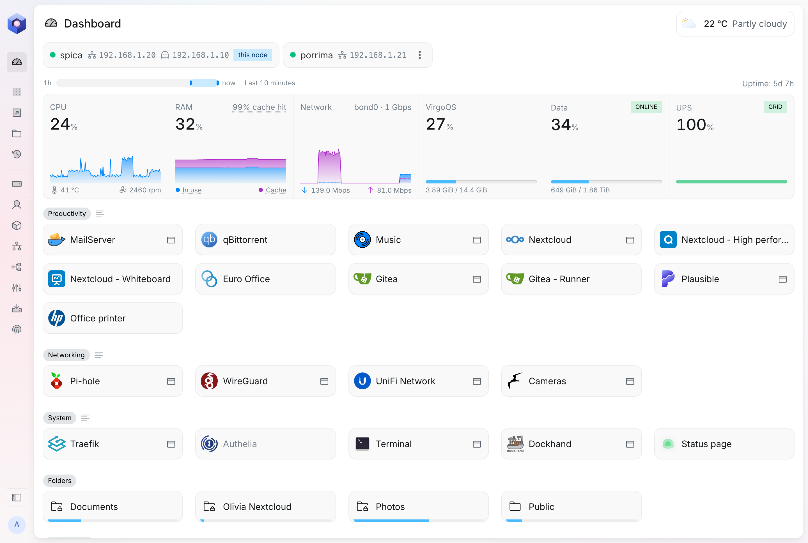
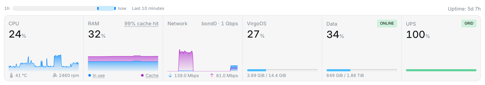
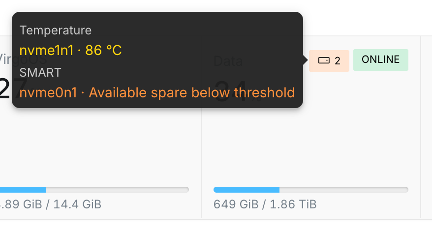
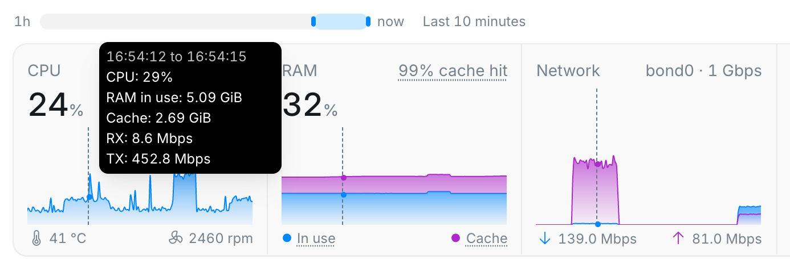
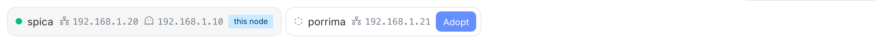
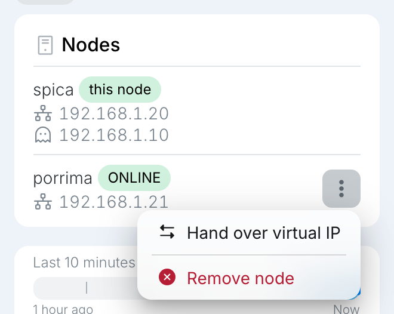
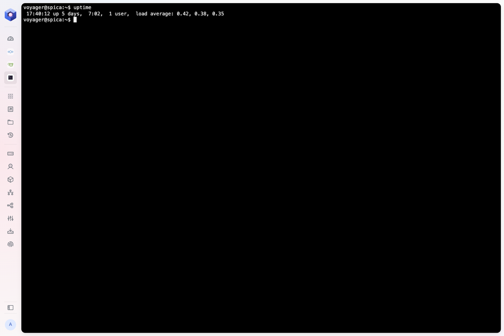
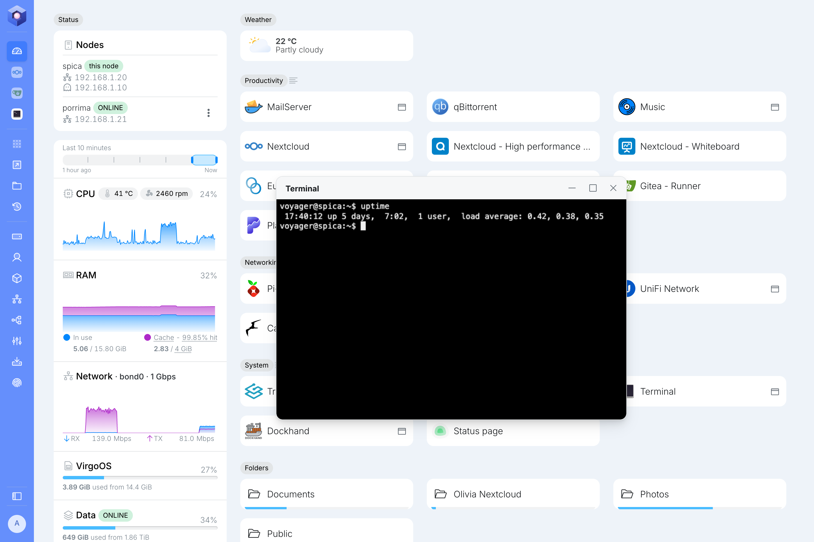
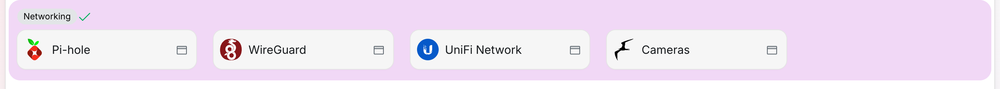
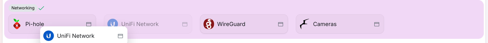

The **Dashboard** is the first page after signing in. It shows how the node is doing, and brings its apps, shortcuts, folders and time machines together in one place. This page describes it as administrators see it.

## Status

The top of the **Dashboard** shows the node's resources as they change, in one row of columns. Above them, **Uptime** shows how long the node has been running since it last started.

- **CPU:** how busy the processor is, with a chart over time. Under the chart: its temperature, and the fan speed when the node has a fan.
- **RAM:** how much memory is in use, with a chart where the cache is stacked on top. See [RAM](#ram) below.
- **Network:** the traffic on the node's network connection over time, with the connection's name and speed at the top. Under the chart: received (↓) and sent (↑).
- **VirgoOS:** how full the system drive is, with the space used under the bar.
- **Data:** how full the [storage pool](/management/system/storage/) is, with its health at the top and the space used under the bar. While a data integrity check runs, its progress shows above the bar.
- **UPS:** how charged the battery is, and whether the node runs on the grid or on battery. See [UPS](/management/ups/) for what happens during a power cut.

A percentage turns orange from 80% and red from 90%. The **Data** and **UPS** columns turn yellow, orange or red as a whole when something needs attention, such as a degraded pool or a node running on battery.

### Drives

Next to the pool's health, and next to **VirgoOS** for the system drive, a badge with a drive icon and a number appears when drives need attention. The number is how many. A drive counts when:

- it gets too warm, in yellow, or too hot, in red;
- its own health check (SMART) reports a warning, in orange, or an error, in red;
- the pool reports read, write or checksum errors on it, or no longer uses it, in red.

The badge takes the color of the worst one. Hover over it to see each drive and what it reports. Select it to open [Storage](/management/system/storage/).

### RAM

The RAM chart splits the node's memory in two parts that add up:

- **In use:** memory that apps, system services and the node itself hold. The percentage at the top of the column counts only this part.
- **Cache:** recently used files and folders kept in memory, so opening them again does not need the drives. Its limit is the most memory it may use, which you set in [RAM cache](/management/system/settings/#ram-cache).

The cache is the ZFS ARC, the memory cache of the storage pool. It fills up as files are read and keeps the ones that are read again. It gives memory back when apps need it, so it is not counted as in use. A cache well below its limit is normal: it only grows as far as the files you use need.

At the top of the column, the cache hit rate is the share of reads served from memory instead of the drives, counted since the node last started. Higher is better: above 90% the cache is doing its job. A lower rate on a node that keeps reading the same files suggests a larger limit would help. Some work, such as copying or streaming large files once, keeps the rate low whatever the limit, because those files are not read again.

Hover over **In use** or **Cache** to see how much memory each part holds, and over the underlined text for a short reminder of each part.

### Looking back

The node records CPU, RAM and network every second and keeps the last hour, even while nobody has the page open. The bar above the columns picks which part of that hour the three charts show, and names that part next to it. It starts at the last 10 minutes and follows along as time passes.

- Drag the highlighted box back along the bar to see an earlier moment. The charts stay on that moment until you drag the box back to the right end, where they follow along again.
- Drag either end of the box to show more or less time, up to the whole hour.
- Select anywhere else on the bar to move the box there.
- Double-click the bar to go back to the last 10 minutes.

Hover over any of the charts to see the time and every reading at that moment. A line marks the same moment on all three charts.

Each point on a chart is the average reading over a few seconds. Seconds the node did not record, such as while it restarted, show as 0.

## Nodes

When there are other nodes on your network, they are listed at the top of the **Dashboard** together with this one, marked **this node**. Each node shows its address, and the node holding the [virtual IP](/management/system/network/#interface) shows that address too, next to a ghost icon.

### Adopting a node

A node found on your network that is not part of the cluster has a dashed outline and an **Adopt** button.

Adopting it joins it to this node's cluster, where it shares the virtual IP. Each node in the cluster is then reachable at its own name, for example `porrima.virgo.univrs.cloud`, through the same port forwarding.

Only the node holding the virtual IP can adopt another. When **Adopt** is unavailable, hover over it to see why.

### Adopted nodes

An adopted node has a green dot while it can be seen on your network, and a red one when it cannot. Hover over the dot to see which. Open its menu:

- **Hand over virtual IP:** when this node holds the virtual IP, move it to that node.
- **Take over virtual IP:** when that node holds the virtual IP, move it to this node.
- **Remove node:** take the node out of the cluster. The virtual IP stays where it is.

## Apps and shortcuts

Apps and [shortcuts](/management/resources/shortcuts/) are grouped by category. Select a card to open it.

Each app shows how many of its containers are running, for example **1 / 1**: green when all of them are, yellow when only some are, and red when none are. An app that is not running, or has no page of its own such as Gitea Runner, is greyed out and cannot be opened. A green download badge means an update is available for it.

### Opening in a window

On a computer screen, a card with a window icon can also open inside the node's interface, without leaving it for another browser tab. Select the icon to open it. An app with more than one address asks which one to open. Apps that cannot be shown this way, and shortcuts that are not [reached through the node](/management/resources/shortcuts/#reaching-a-device-through-the-node), have no icon.

The window fills the page and gets its own entry in the menu, under **Dashboard**, with the icon and name of what you opened. Several windows can be open at once. Select an entry to hide its window or bring it back. Selecting any other page in the menu hides it too.

With the [menu collapsed](/management/#the-menu), the entries show only their icons, like a dock.

With the menu expanded, hover over an entry, or select it, to show its two icons. The cross closes the window. The icon next to it turns it into a floating window, which you can drag by its title bar, resize from its edges, and minimize, maximize or close with the buttons in its corner.

:::tip
Drag a floating window by its title bar to an edge of the page to fit it to that half, or to a corner to fit it to that quarter. A blue outline shows where it will land. Drag it away again and it goes back to the size it had.
:::

:::tip
Double-click a floating window's title bar to maximize it.
:::

:::tip
Drag the entries in the menu to put the open windows in the order you want.
:::

Open windows are remembered in this browser, in their order. After you reload the page, their entries are back in the menu, and each window loads when you select its entry. Restarting, shutting down or updating the node closes every window.

### Rearranging cards

Select the lines next to a category's name to rearrange its cards. The category turns purple and the lines become a check mark.

Drag and drop the cards into the order you want.

Select the check mark to save the order. It applies to everyone who opens the **Dashboard**.

## Folders and time machines

The [folders](/management/resources/folders/) and [time machines](/management/resources/time-machines/) are listed with a bar showing how full each one is.

## Weather

When a [location](/management/system/settings/#location) is set, the **Weather** card shows the current weather there. Select it for the forecast.
