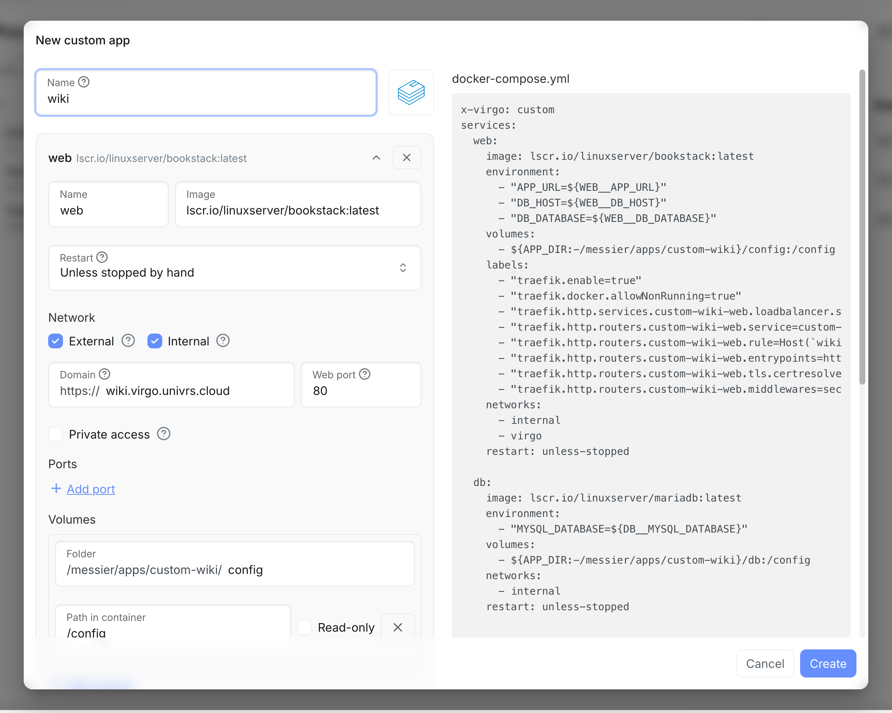
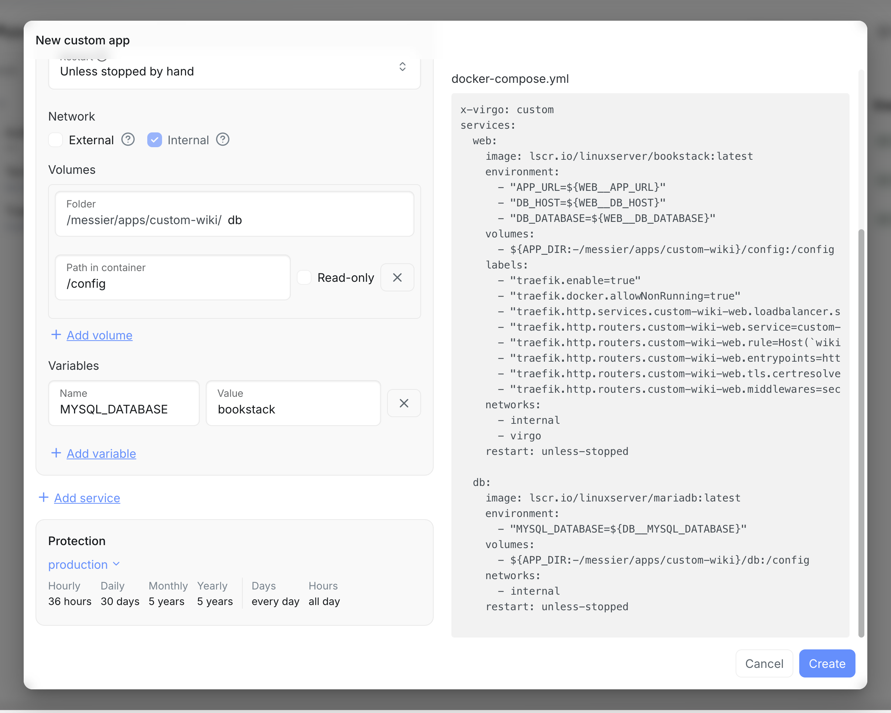
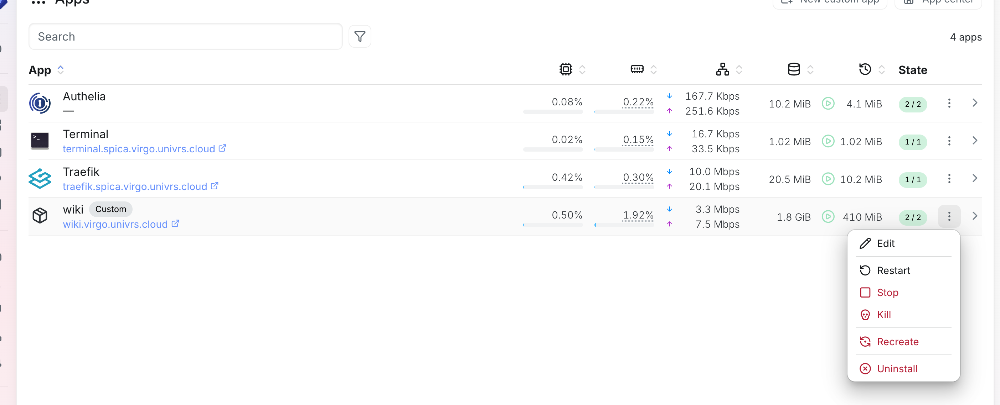

A custom app runs container images you choose, for an app that is not in the App center. You describe it in a form and the node sets it up the same way as an app from the App center: reached over HTTPS through the node, with its data in a storage space of its own that snapshots protect.

## Installing a custom app

On **Apps**, select **New custom app**. The form is on the left. On the right is the `docker-compose.yml` the node writes for the app, which follows every change you make.

Give the app a **Name**. It also names the app's storage space, where its volumes are kept. Select the icon next to it to search for one.

An app is made of one or more services, each running one container. Fill in the first one and select **Add service** for more, for example a database next to the app itself. Select the arrow on a service to fold it away, leaving its name and image showing.

For each service:

- **Name** and **Image:** what the service is called inside the app, and the container image it runs, such as `nginx:latest`.
- **Restart:** when the service starts again after it stops or the node restarts. **Unless stopped by hand** suits most services.
- **Network:** an **External** service can be reached through a domain or ports. An **Internal** service can only reach the other internal services of the same app, which suits a database. A service can be both, like an app that serves web pages and talks to its database.
- **Domain** and **Web port:** the address people open in the browser, and the port the service's web pages listen on inside its container. Leave **Domain** empty when the service has no web pages. An address under the node's domain uses the node's certificate. Any other domain gets a Let's Encrypt certificate, so its DNS has to point to your network and port 80 has to be [forwarded](/setup/ports/) to the node.
- **Private access:** only users logged in to the node can open the address. It is offered for addresses under the node's domain.
- **Redirect www:** for a domain of your own, the service also answers on its `www.` address and sends visitors to the address without it.
- **Ports:** extra ports opened on the node, for services that do not work over the web. Each one connects a **Node port** to a **Container port**, over TCP, UDP or both.
- **Volumes:** folders in the app's storage space, each mounted at a **Path in container**. Mark a volume **Read-only** when the service only reads it. Anything a service writes outside its volumes is lost when it is recreated or updated.
- **Variables:** settings handed to the service, such as the name of its database.

**Protection** at the end picks the [snapshot rule](/management/resources/snapshot-rules/) for the app's volumes, starting with the default rule, or **No snapshots**. An app without volumes keeps no data, so it takes no snapshots.

Select **Create**. A notification follows the installation while the node makes the app's storage space, downloads each service's image and starts the app, which then appears in the list.

## Managing a custom app

Custom apps are marked **Custom** in the list. They have the same actions as other apps, plus **Edit**.

**Edit** opens the same form with the app's current settings. Its name can't be changed. Select **Update** to apply the changes: the node restarts the services that changed and removes the ones you took out. The folders of a removed service stay in the app's storage space.

When an update is available, **Update** downloads newer versions of the app's images. **Recreate** rebuilds its containers from the form's settings.
