**Apps** lists the apps installed on the node. The core apps installed during [setup](/setup/apps/) are always there; every other app is installed from the **App center**.

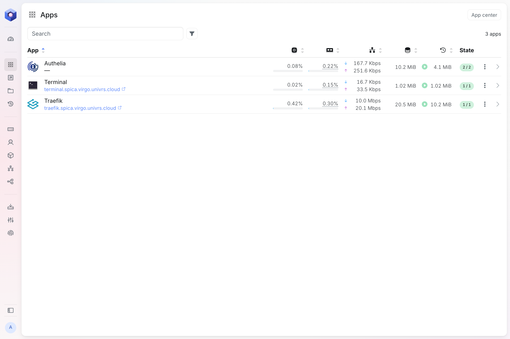

For each app, the list shows its name and addresses, how much CPU, RAM and network it uses, how much space its data and its snapshots take up, and its state: how many of its containers are running, green when all of them are, yellow when only some are, and red when none are. The icon next to the snapshots figure says whether the app's [snapshots](/management/resources/apps/snapshots/#snapshotting) are enabled, paused or disabled. Select an address to open the app. Sort the list by name or by any of the figures with the arrows in the column headers, and use **Search** to find an app by its name or address.

Narrow the list down with the filter button next to **Search**: **Status** for whether the app is running, partly running or stopped, **Updates** for whether an update is available, **Snapshots** for whether its snapshots are enabled, paused or disabled, and **Category**. A choice in use turns blue and the button counts the filters in use. **Reset filters** removes them all.

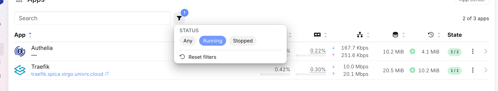

## Installing an app

Select **App center**. **Explore** lists the apps you can install, and **Installed** the ones already on the node.

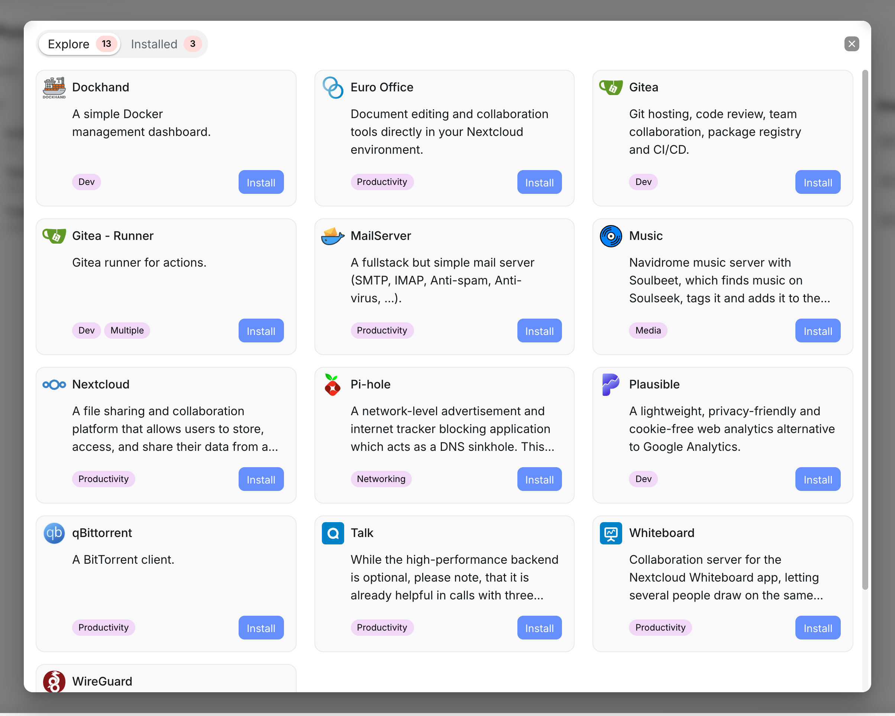

Select **Install** on an app. The form describes the app, shows any note that comes with it, such as a port to forward on your router, and asks for the settings it needs. **Domain** is filled in with the node's domain, and the app is reached at its own name under it, for example `nextcloud.virgo.univrs.cloud`.

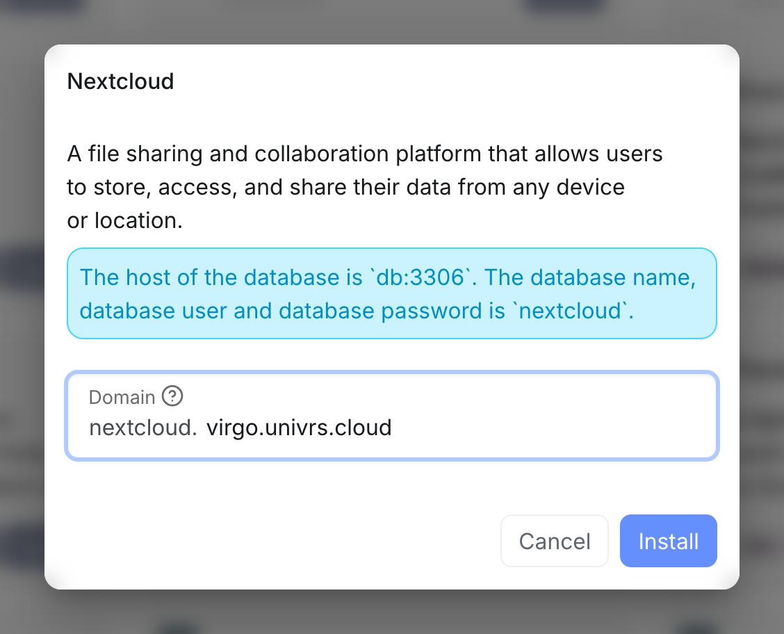

With a domain of your own, you also choose the app's HTTPS certificate, starting from the one the node uses:

- **Let's Encrypt:** when the domain's DNS points to your network and port 80 is [forwarded](/setup/ports/) to the node. Browsers trust it everywhere.
- **Self-signed:** when port 80 is not forwarded, for example when the node is only used on your local network or is behind CGNAT. Browsers warn about it until you accept it.

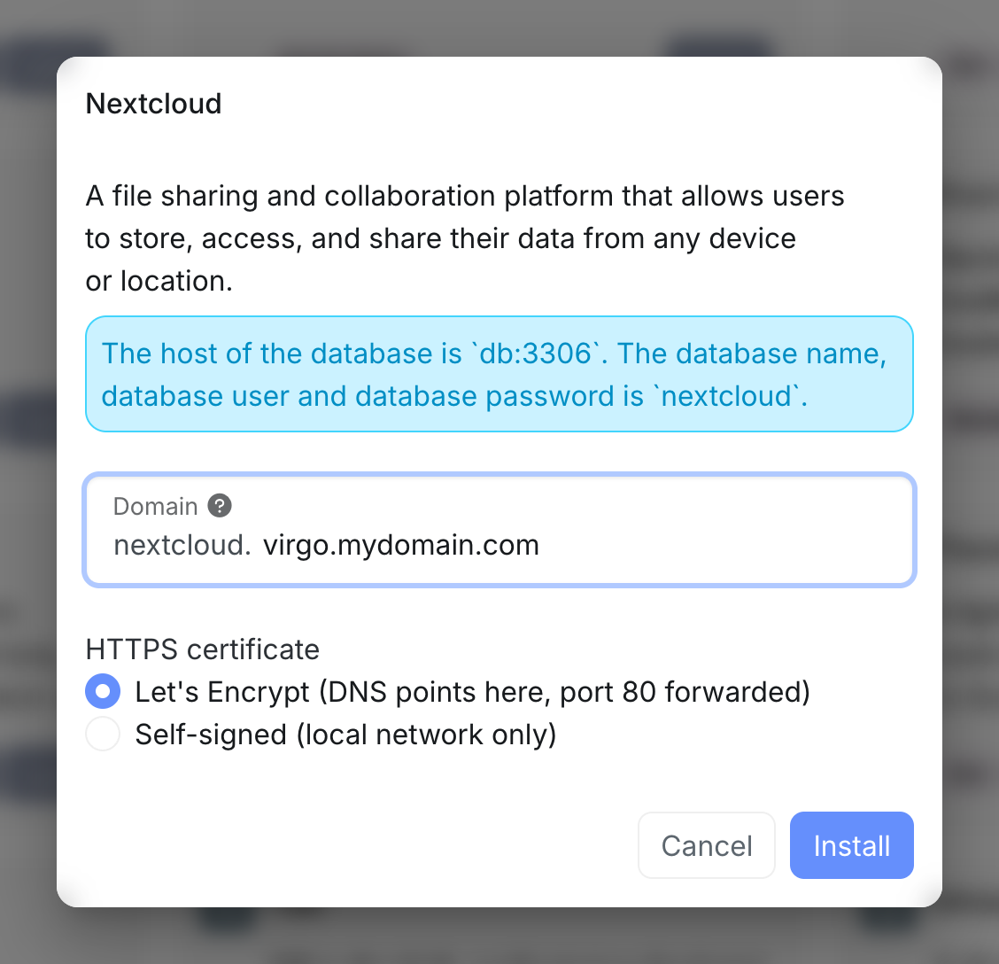

While the app installs, its card shows **Installing...**. The node makes room for the app's data in the storage pool, downloads the app and starts it, and the app then appears in the list.

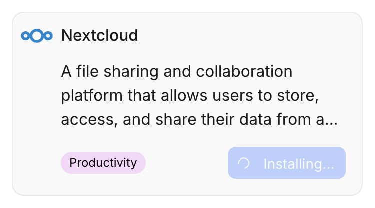

## Managing an app

Open an app's menu in the list, or use the buttons at the top of its details:

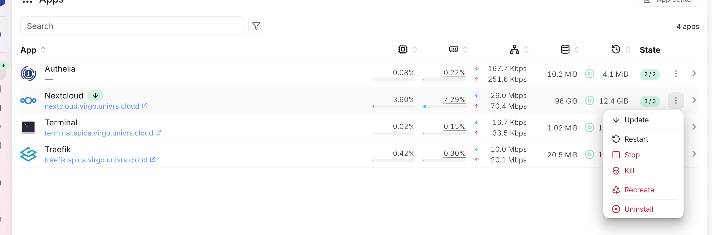

- **Update:** when an update is available, bring the app up to date. See [Updating an app](#updating-an-app).
- **Start**, **Restart** and **Stop:** start, restart or stop all of the app's containers.
- **Kill:** stop the app at once, without giving it time to shut down properly.
- **Recreate:** rebuild the app's containers from its template in the App center, keeping its settings and data.
- **Uninstall:** remove the app. Its data stays in the storage pool, and installing the app again picks it back up.

The core apps cannot be stopped, killed or uninstalled, because the node needs them.

:::tip
When an app misbehaves, **Recreate** it. Use **Kill** only when **Stop** does not work.
:::

While an action is running, a spinning gear takes the place of the menu.

### Updating an app

The node checks for app updates every day at midnight. When one is available, a green download badge appears next to the app's name. Select **Update** in its menu.

A notification follows the update while a spinning gear takes the place of the app's menu. The node fetches the app's latest template, downloads the new version of each of its containers, and restarts the app on it.

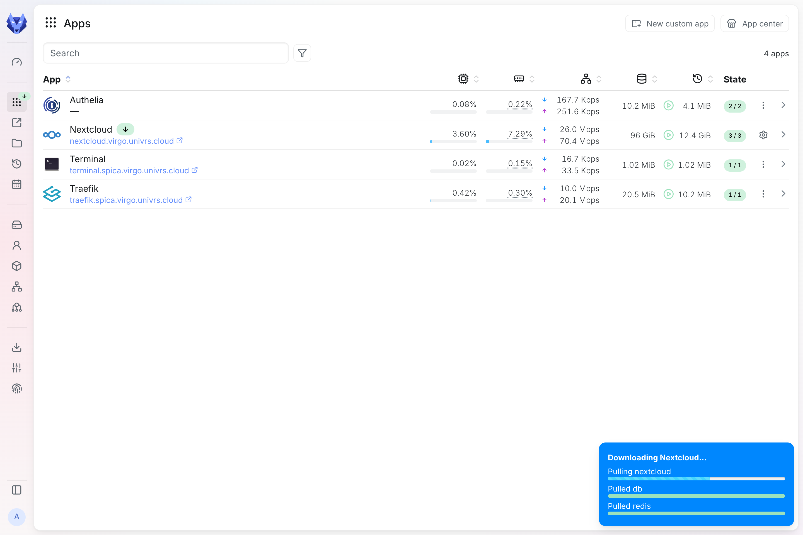

When the update finishes, the notification says so and the badge disappears. The app keeps its settings and data.

Before updating, the node takes a snapshot of the app. If the new version does not work out, [roll back](/management/resources/apps/snapshots/rollback/) to it.

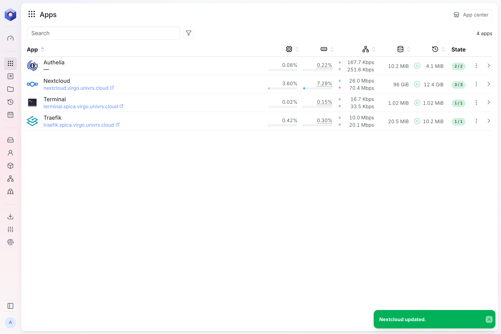

### Updating Nextcloud apps

The apps added inside Nextcloud, such as Calendar or Contacts, have updates of their own. Open Nextcloud's details and select **Apps**: it lists each app with a newer version, from the version it runs to the new one, and the tab counts them. Select **What's new** under an app to read what changed in the new version.

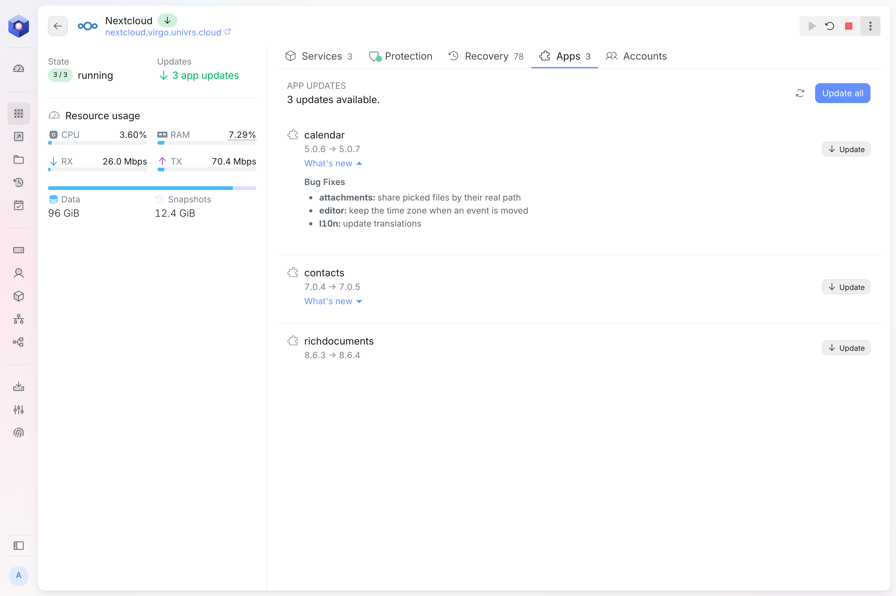

The node checks for them every day at midnight. When one is available, the same green download badge appears next to Nextcloud's name. Select the circular arrows to check now. Select **Update** on an app to update only that one, or **Update all**. A notification follows the update while a spinning gear takes the place of the buttons, and the app leaves the list once it is up to date.

While Nextcloud itself has an update, the buttons in **Apps** are turned off: select **Update** at the top instead. Its apps are updated first, while Nextcloud is still running, and Nextcloud is updated right after. The spinning gear stays until both are done.

## An app's details

Select an app to open its details. **Services** shows the app's containers and **Recovery** its [restore points](/management/resources/apps/snapshots/#restore-points), each with how many there are. **Protection** says how its [snapshots](/management/resources/apps/snapshots/#snapshotting) are taken. Nextcloud also has **Apps**, for [its own apps' updates](#updating-nextcloud-apps). MailServer also has **Domains**, **Accounts** and **Blocked IPs**, for [managing its mail](#managing-mailserver).

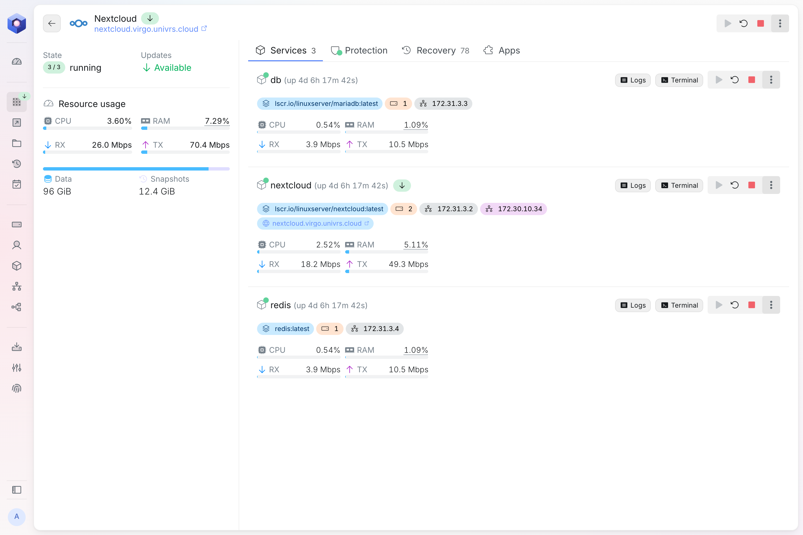

Each container is listed with its image, the folders it mounts, its network addresses and ports, and how much CPU, RAM and network it uses. The dot on its icon is green while it runs, and its name shows how long it has been up since it last started. Hover over a badge for more, such as where each folder is mounted from. Each container can be started, restarted, stopped or killed on its own, with the buttons at the end of its row.

### Logs

Select **Logs** on a container to see its last 200 lines of output, followed by new lines as they come in.

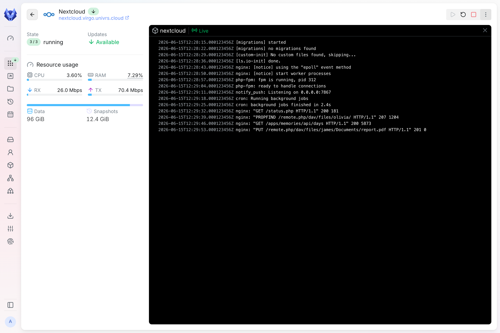

### Terminal

Select **Terminal** on a running container to open a command line inside it. Anything you change there outside the app's data is lost when the app is recreated or updated.

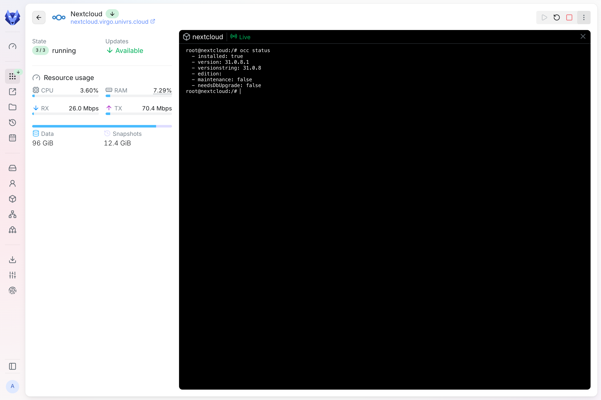

:::tip
Press **Ctrl+F**, or **⌘F** on a Mac, to find text in the terminal. **Enter** goes to the next match, **Shift+Enter** to the previous one, and **Esc** closes the search.
:::

## Managing MailServer

Open MailServer's details to manage the mail it handles. Changes need MailServer to be running; while it is stopped, the tabs only show what is there.

### Domains

**Domains** lists the domains MailServer receives mail for, with how many accounts and aliases each has. Select **New domain** to add one. Adding a domain creates its DKIM key, which signs the mail sent from it so receiving servers can trust it. Once it is added, a notification stays open until you close it, because mail for the domain only works after its DNS records are in place and the mail ports are forwarded on your router. Select **Show me how** in it for both steps.

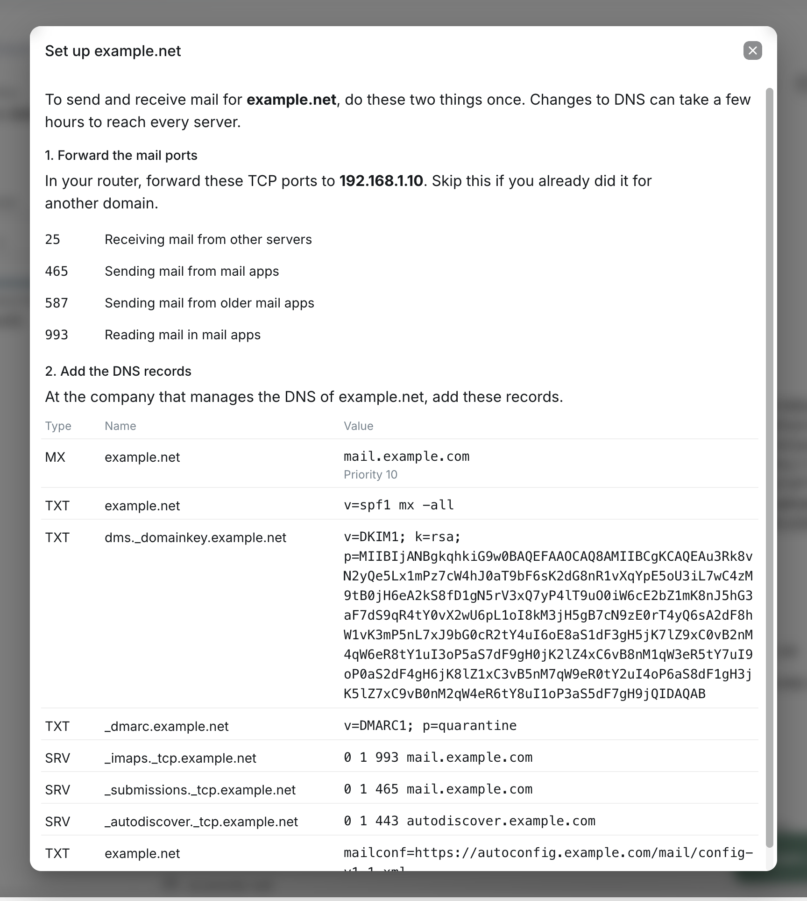

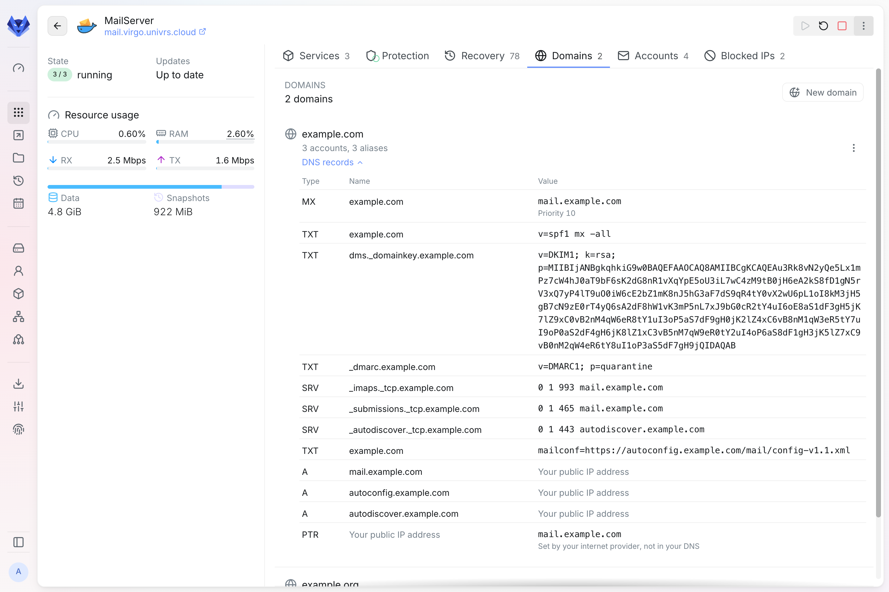

Select **DNS records** under a domain to see every record to add to that domain's DNS, with its type, name and value: where its mail is delivered, which servers may send it, its DKIM key, what to do with mail that fails those checks, and how mail apps find their settings. The domain MailServer runs on also needs its mail host pointed at your public IP address, and your internet provider has to point that address back to the mail host. A domain without a key is marked in orange: select **Create DKIM key** in its menu. **New DKIM key** replaces the key; the old record stops working, so update the DNS right away. **Remove** deletes the domain and its key, once it has no accounts or aliases left.

### Accounts

**Accounts** lists the mailboxes, each with the space its mail takes up and its storage limit, and under each one the aliases that deliver to it. Aliases that forward to addresses outside MailServer are grouped at the end, under **Forwarded elsewhere**.

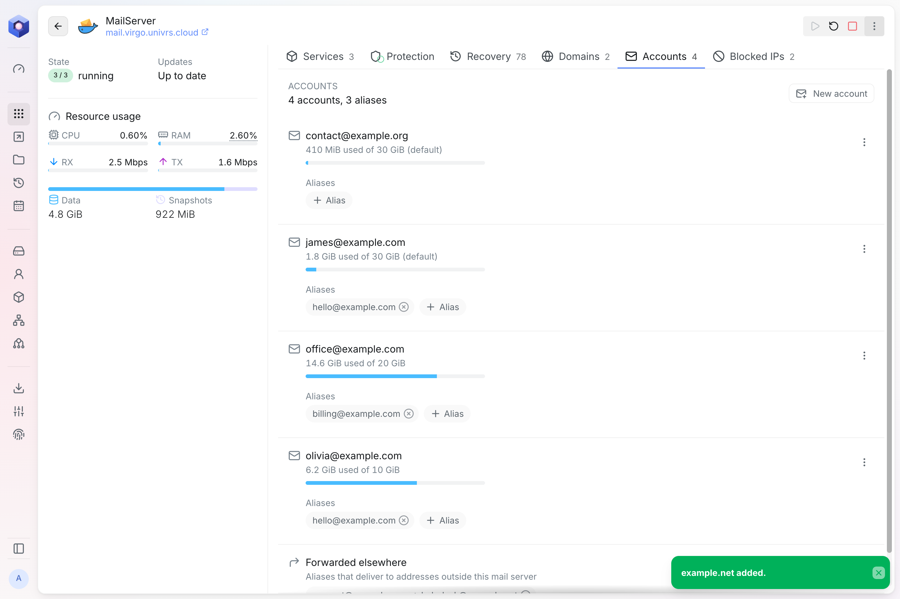

Select **New account** to create a mailbox: pick its domain, which starts on MailServer's own domain, then its name, and set its password. The storage limit starts at MailServer's default; keep it, or change it to give the account a limit of its own. Accounts on the default are marked **(default)** in the list. Check **No storage limit** to let it grow without a limit.

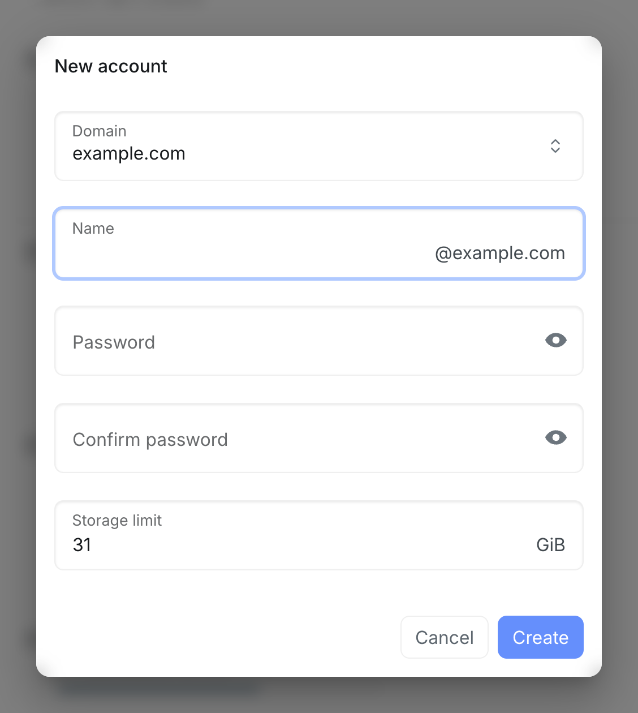

An account's menu changes its password or storage limit, adds an alias that delivers to it, or removes it. Removing an account permanently deletes all of its mail and its aliases. Select the cross next to an alias to remove it.

### Blocked IPs

MailServer blocks addresses that keep failing to log in. **Blocked IPs** lists them, with why each one was blocked, since when, and until when. Select **Unblock** to let an address back in, or **New blocked IP** to block one yourself.

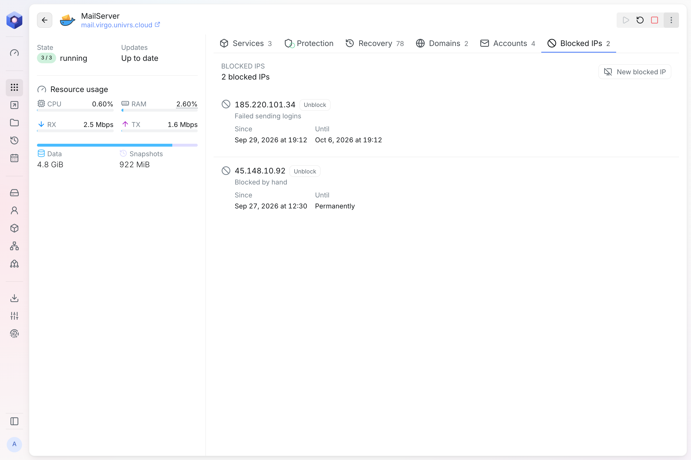
