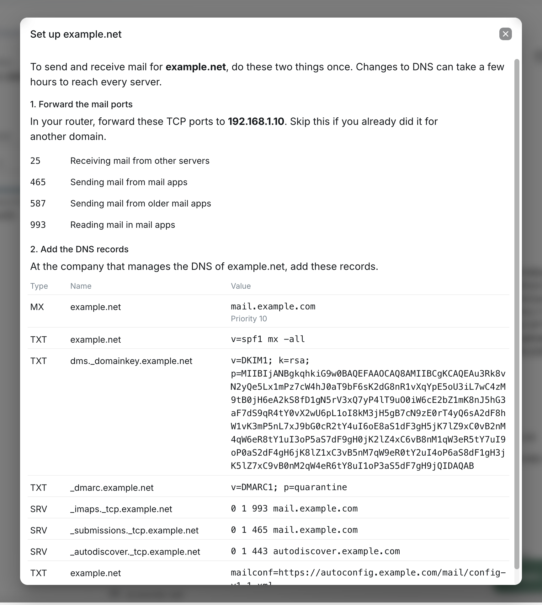
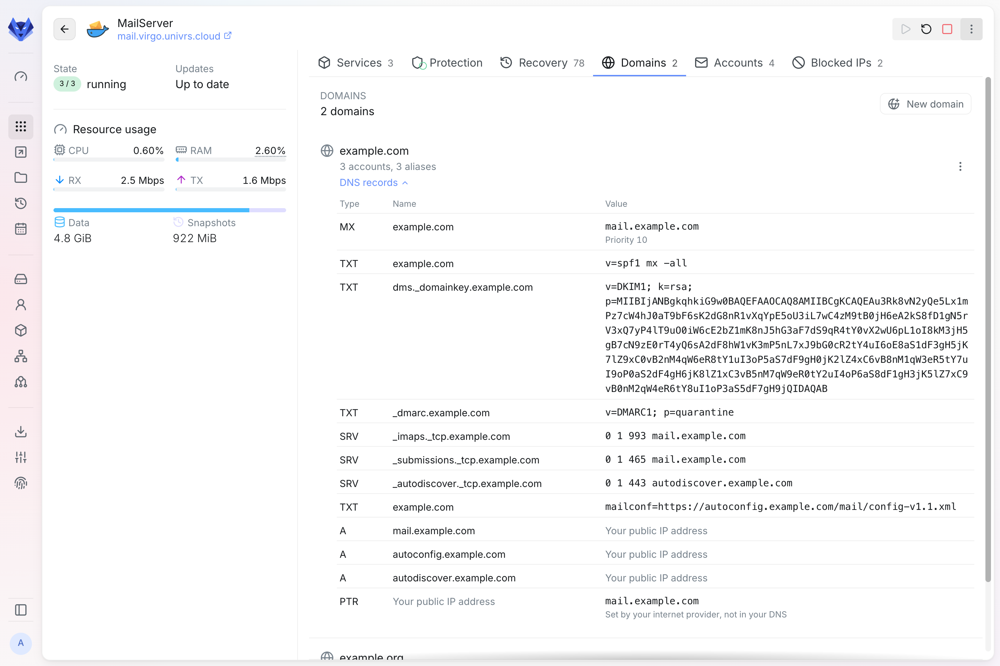
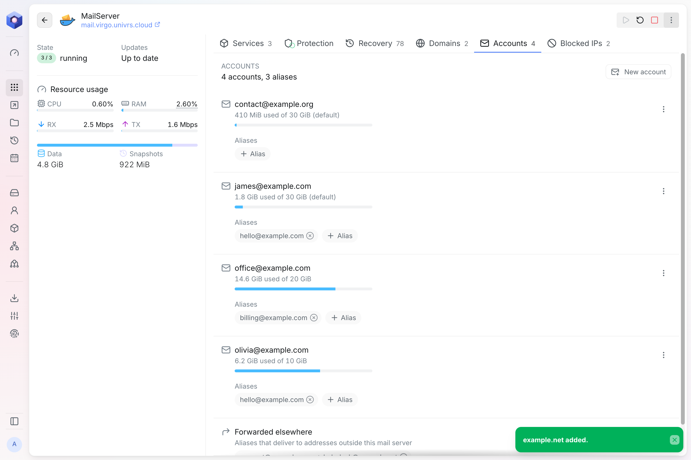
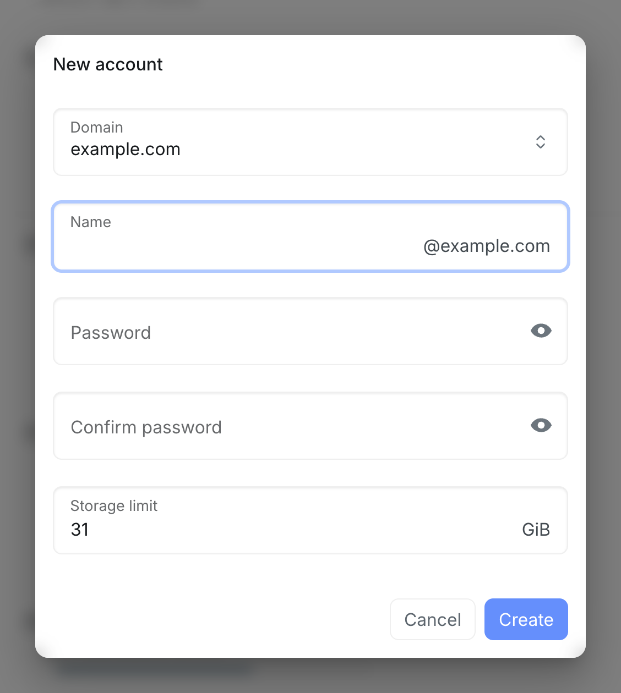
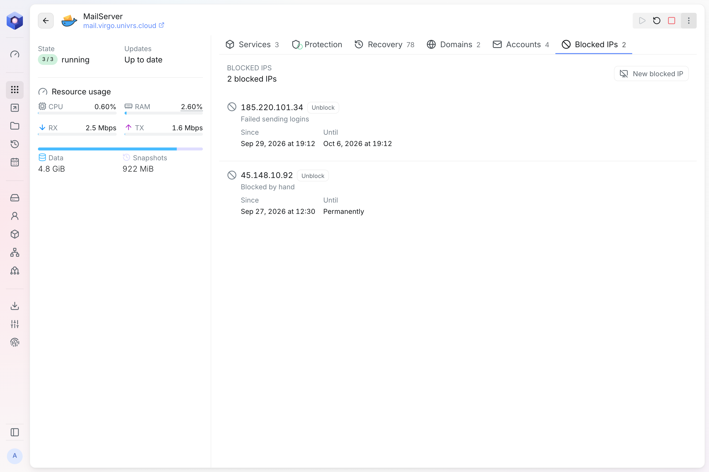

Open MailServer's details to manage the mail it handles.

## Domains

**Domains** lists the domains MailServer receives mail for, with how many accounts and aliases each has. Select **New domain** to add one. Adding a domain creates its DKIM key, which signs the mail sent from it so receiving servers can trust it. Once it is added, a notification stays open until you close it, because mail for the domain only works after its DNS records are in place and the mail ports are forwarded on your router. Select **Show me how** in it for both steps.

Select **DNS records** under a domain to see every record to add to that domain's DNS, with its type, name and value: where its mail is delivered, which servers may send it, its DKIM key, what to do with mail that fails those checks, and how mail apps find their settings. The domain MailServer runs on also needs its mail host pointed at your public IP address, and your internet provider has to point that address back to the mail host. A domain without a key is marked in orange: select **Create DKIM key** in its menu. **New DKIM key** replaces the key; the old record stops working, so update the DNS right away. **Delete** removes the domain and its key, once it has no accounts or aliases left.

## Accounts

**Accounts** lists the mailboxes, each with the space its mail takes up and its storage limit, and under each one the aliases that deliver to it. Aliases that forward to addresses outside MailServer are grouped at the end, under **Forwarded elsewhere**.

Select **New account** to create a mailbox: pick its domain, which starts on MailServer's own domain, then its name, and set its password. The storage limit starts at MailServer's default; keep it, or change it to give the account a limit of its own. Accounts on the default are marked **(default)** in the list.

An account's menu changes its password or storage limit, or deletes it. Deleting an account permanently deletes all of its mail and its aliases. Select **Alias** after an account's aliases to add one that delivers to it, or the cross on an alias to remove it.

## Blocked IPs

MailServer blocks addresses that keep failing to log in. **Blocked IPs** lists them, with why each one was blocked, since when, and until when. Select **Unblock** to let an address back in, or **New blocked IP** to block one yourself.

