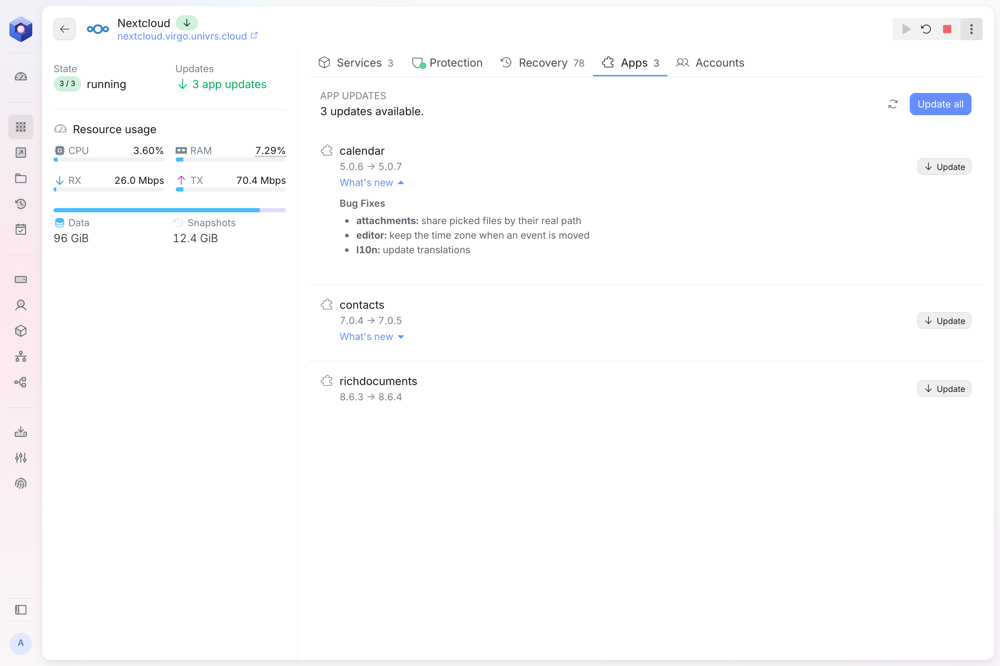
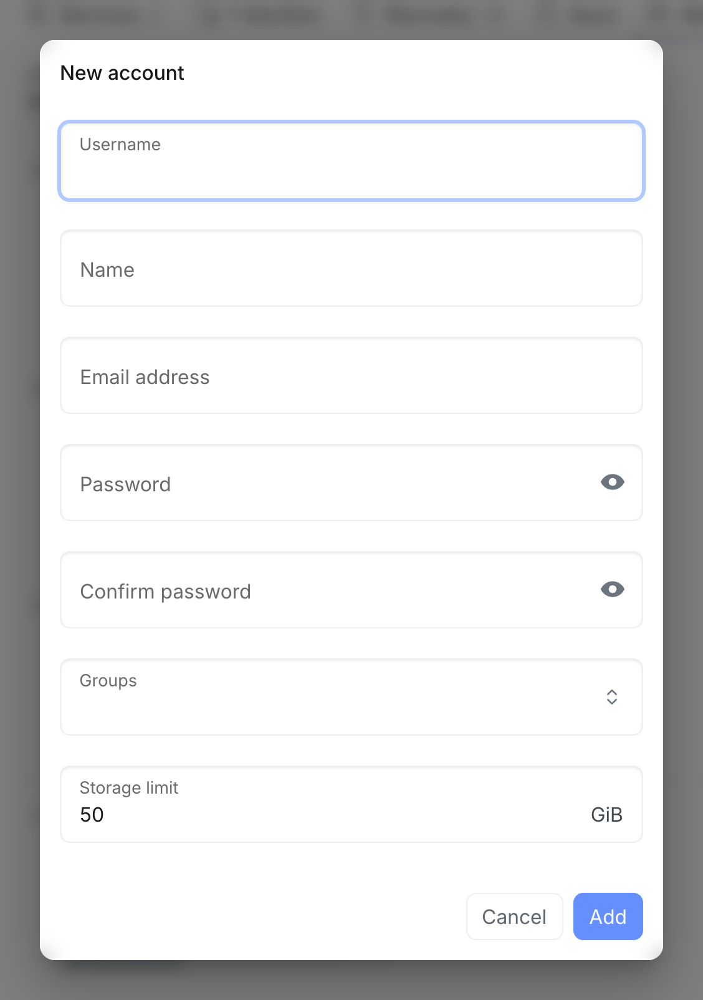
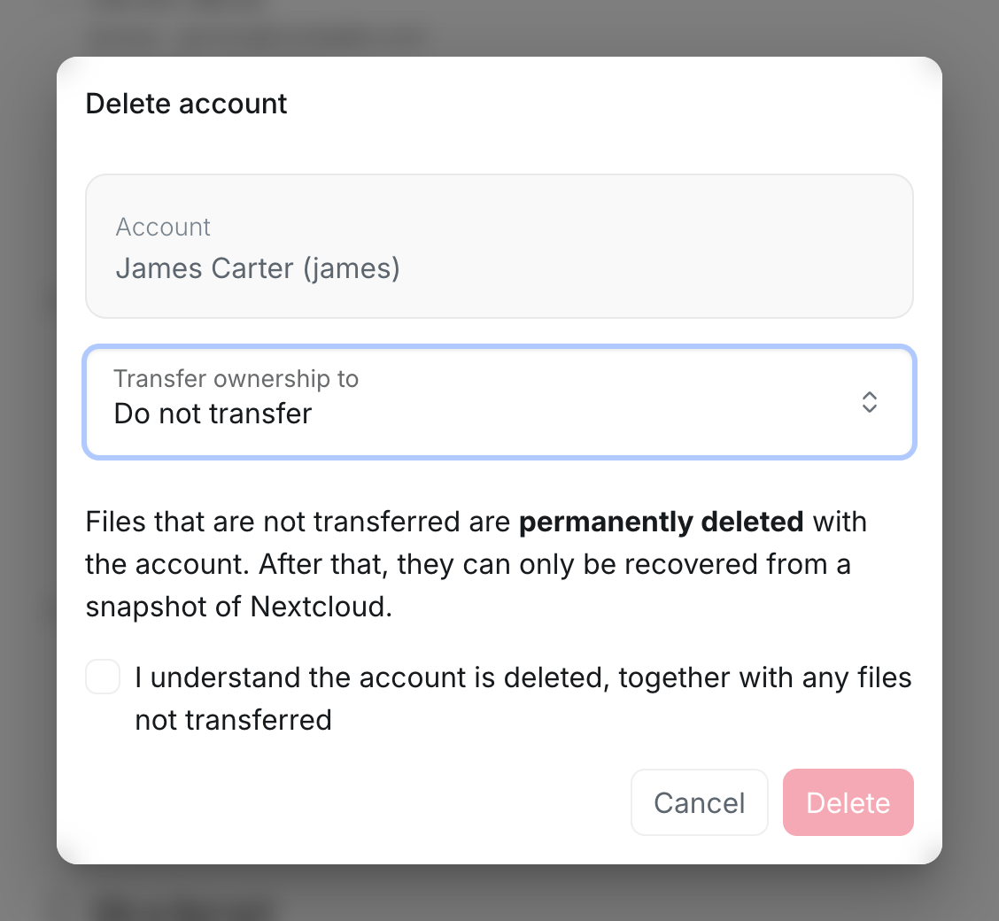
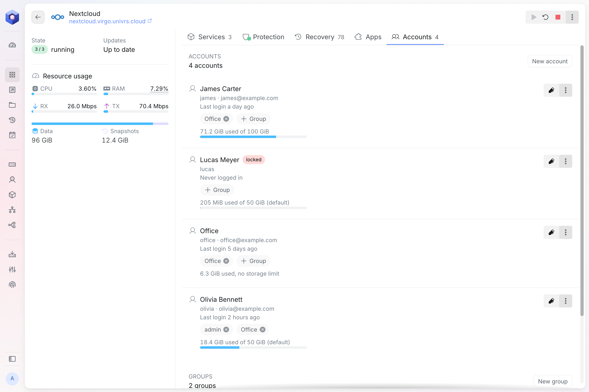

Open Nextcloud's details to update the apps added inside it and to manage its accounts.

## Updating Nextcloud apps

The apps added inside Nextcloud, such as Calendar or Contacts, have updates of their own. Open Nextcloud's details and select **Apps**: it lists each app with a newer version, from the version it runs to the new one, and the tab counts them. Select **What's new** under an app to read what changed in the new version.

The node checks for them every day at midnight. When one is available, the same green download badge as for an [app update](/management/resources/apps/#updating-an-app) appears next to Nextcloud's name. Select the circular arrows to check now. Select **Update** on an app to update only that one, or **Update all**. A notification follows the update while a spinning gear takes the place of the buttons, and the app leaves the list once it is up to date.

While Nextcloud itself has an update, the buttons in **Apps** are turned off: select **Update** at the top instead. Its apps are updated first, while Nextcloud is still running, and Nextcloud is updated right after. The spinning gear stays until both are done.

## Accounts

Nextcloud keeps its own accounts, separate from the node's users. Open Nextcloud's details and select **Accounts** to see them: each user with their username, email, groups, last login and the space their files take up against their storage limit, marked **(default)** when they use Nextcloud's default limit. Locked users are marked as such. Select **New account** to add one: give it a username, a name, an email address, any groups, a password and a storage limit, which starts at Nextcloud's default.

The pencil next to an account edits its name, email address and storage limit. Its menu changes its password. It also locks the account, so it can no longer log in or sync while its files are kept, and unlocks it again. To delete an account, select **Delete** in its menu. Under **Transfer ownership to**, pick another account to receive its files, or keep **Do not transfer**. Files that are not transferred are deleted with the account and can then only be recovered from a snapshot, so the dialog asks you to confirm that before **Delete** works. The receiving account needs enough free space under its storage limit. Nextcloud's last administrator can't be locked or deleted.

Select the cross on one of a user's groups to take them out of it, or the plus to add them to another group. The last member of the `admin` group can't be taken out, because Nextcloud needs an administrator. Below the users, **Groups** lists each group with how many members it has. Select **New group** to add one, giving it just a name. A group's menu deletes it: its members keep their accounts and files, but lose what was shared with the group. The `admin` group can't be deleted, and groups are renamed in Nextcloud itself.

