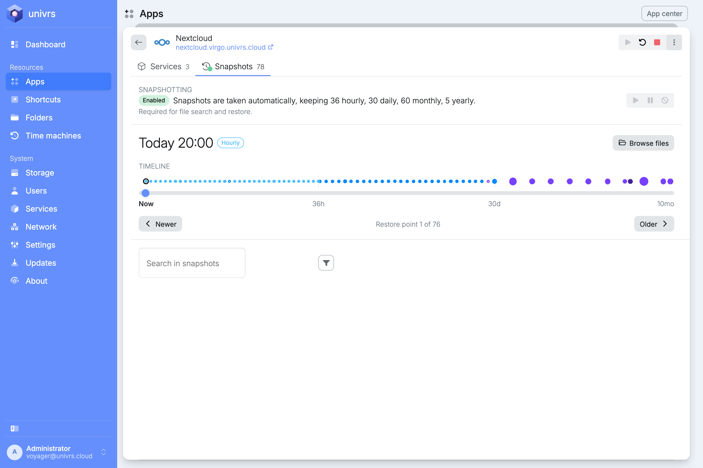

A snapshot is a read-only copy of an app's data as it was at one moment. The node takes them by itself and removes old ones, following the pool's [snapshot schedule](/management/system/storage/#usage). A snapshot only takes up space for what has changed since it was taken, so keeping many of them costs little.

Open an app's details and select **Snapshots**.

## Snapshotting

The top of the tab says whether the node takes snapshots of this app, and how many of each kind it keeps. The buttons next to it change that:

- **Pause:** stop taking new snapshots. The ones already taken are kept.
- **Disable:** stop taking snapshots and delete the ones already taken, after you confirm.
- **Resume** or **Enable:** take snapshots again.

:::caution
Disabling snapshots permanently deletes every snapshot of the app. Without them, its data cannot be recovered after an accidental deletion, a corruption or a failed update. To keep the existing snapshots, pause them instead.
:::

The dot on the **Snapshots** tab shows the same state: green for enabled, orange for paused and grey for disabled.

For some apps the buttons are greyed out, and the line under the state says why. Nextcloud's snapshots, for example, cannot be paused or disabled, because searching and restoring its files relies on them.

## Restore points

Snapshots taken at the same moment by different schedules, such as the daily and the monthly one at midnight on the first of the month, are shown together as one restore point.

The selected restore point shows when it was taken and the schedules that keep it: **Frequently**, **Hourly**, **Daily**, **Monthly** or **Yearly**.

### Timeline

The timeline runs from **Now** on the left to the oldest restore point on the right. Each schedule gets an equal stretch of it, so the many recent restore points are spread out and the few old ones fit in too. The marks under it show how far back each stretch reaches.

Each dot is a restore point. The bigger the dot, the more space it takes up, which is the data that only this restore point still holds. A hollow dot holds nothing that the others do not. Hover over a dot to see its details.

To choose a restore point, select its dot, drag the slider, or use **Newer** and **Older**. With the slider selected, the arrow keys step from one restore point to the next.

:::tip
With the slider selected, **Home** jumps to the newest restore point and **End** to the oldest.
:::

On a narrow screen, the timeline becomes a set of orbits around the app's icon, one per schedule, going round clockwise from **Now**.

## Getting files back

Nextcloud's restore points can be opened, to get back the files people keep in it. Which way in is quickest depends on what you know:

| You know | Start here |
| --- | --- |
| Roughly when things were still right | [Browse files](/management/resources/apps/snapshots/browse/) of that restore point, see what changed since, and pick what you need |
| The name of the file, but not when it went missing | [Search](/management/resources/apps/snapshots/search/) every restore point at once |
| Which version you want | [Restore](/management/resources/apps/snapshots/restore/) it into Nextcloud, or download it to your computer |

The two meet in the middle: every search result can be opened in **Browse files**, at its folder and its date.

The node catalogues the files in Nextcloud's snapshots by itself, every hour at ten past. Searching, and what **Browse files** says about changes, both rely on that catalogue, so the newest changes show up after its next run.

Other apps have restore points and a timeline, but their files cannot be browsed, searched or restored from here.
