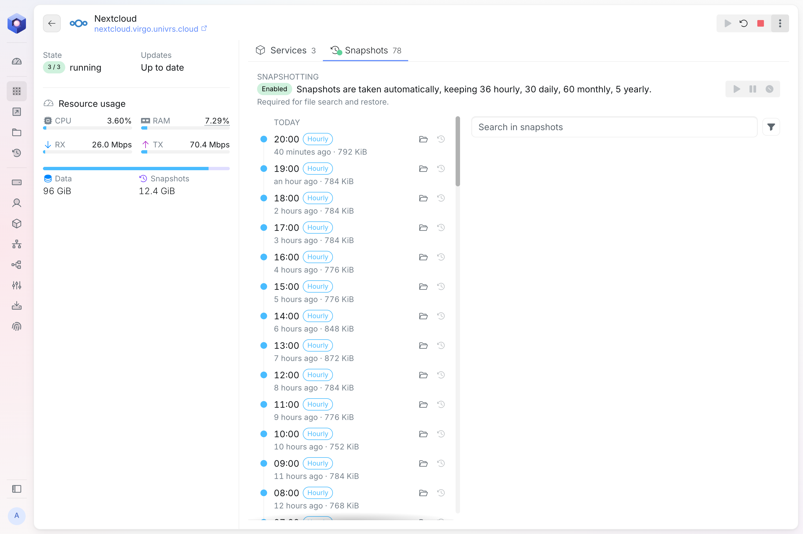

A snapshot is a read-only copy of an app's data as it was at one moment. The node takes them by itself and removes old ones, following the pool's [snapshot schedule](/management/system/storage/#usage). A snapshot only takes up space for what has changed since it was taken, so keeping many of them costs little.

Open an app's details and select **Snapshots**.

## Snapshotting

The top of the tab says whether the node takes snapshots of this app, and how many of each kind it keeps. The buttons next to it change that:

- **Pause:** stop taking new snapshots. The ones already taken are kept.
- **Disable:** stop taking snapshots and delete the ones already taken, after you confirm.
- **Resume** or **Enable:** take snapshots again.

:::caution
Disabling snapshots permanently deletes every snapshot of the app. Without them, its data cannot be recovered after an accidental deletion, a corruption or a failed update. To keep the existing snapshots, pause them instead.
:::

The dot on the **Snapshots** tab shows the same state: green for enabled, orange for paused and grey for disabled.

For some apps the buttons are greyed out, and the line under the state says why. Nextcloud's snapshots, for example, cannot be paused or disabled, because searching and restoring its files relies on them.

## Restore points

Snapshots taken at the same moment by different schedules, such as the daily and the monthly one at midnight on the first of the month, are shown together as one restore point.

Each restore point shows the schedules that keep it: **Frequently**, **Hourly**, **Daily**, **Monthly** or **Yearly**. **Update** marks the snapshot the node takes right before it [updates the app](/management/resources/apps/#updating-an-app). Only the one from the latest update is kept.

### Timeline

The timeline lists the restore points from the newest at the top to the oldest at the bottom.

Hourly restore points are grouped under their day, **Today**, **Yesterday** or a date, and show only their time. The others show when they were taken: a daily one its day, a monthly or yearly one its month, and an update its day and time.

Under each restore point are how long ago it was taken and how much space it takes up, which is the data that only this restore point still holds. A hollow dot holds nothing that the others do not.

Next to each restore point are its buttons. Hover over one to see its name:

- **Browse files** opens the restore point's files, for Nextcloud.
- **Roll back** puts the app back as it was, from the **Update** restore point.

On a narrow screen, the search comes first and the timeline follows under it.

## Rolling back

An app can be put back as a whole, with its data, settings and versions, to the snapshot taken before its latest update. See [Rolling back](/management/resources/apps/snapshots/rollback/).

## Getting files back

Nextcloud's restore points can be opened, to get back the files people keep in it. Which way in is quickest depends on what you know:

| You know | Start here |
| --- | --- |
| Roughly when things were still right | [Browse files](/management/resources/apps/snapshots/browse/) of that restore point, see what changed since, and pick what you need |
| The name of the file, but not when it went missing | [Search](/management/resources/apps/snapshots/search/) every restore point at once |
| Which version you want | [Restore](/management/resources/apps/snapshots/restore/) it into Nextcloud, or download it to your computer |

The two meet in the middle: every search result can be opened in **Browse files**, at its folder and its date.

A Nextcloud user's files that are shared as a [folder](/management/resources/folders/snapshots/) can be searched, browsed and restored from that folder too, limited to that user's files.

The node catalogues the files in Nextcloud's snapshots by itself, every hour at ten past. Searching, and what **Browse files** says about changes, both rely on that catalogue, so the newest changes show up after its next run.

Other apps have restore points and a timeline, but their files cannot be browsed, searched or restored from here.
