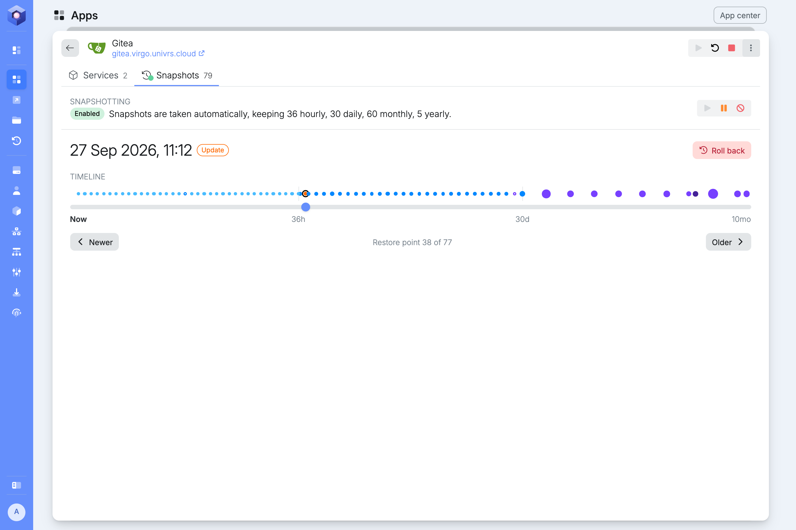
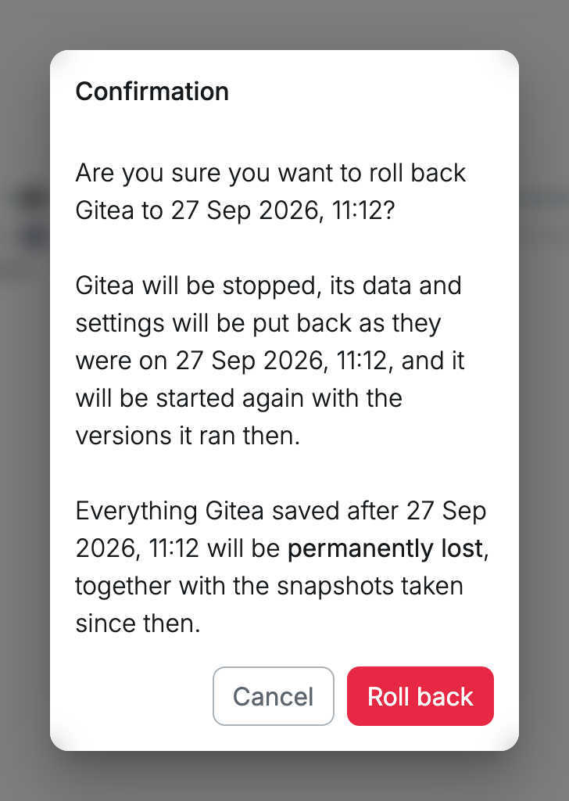
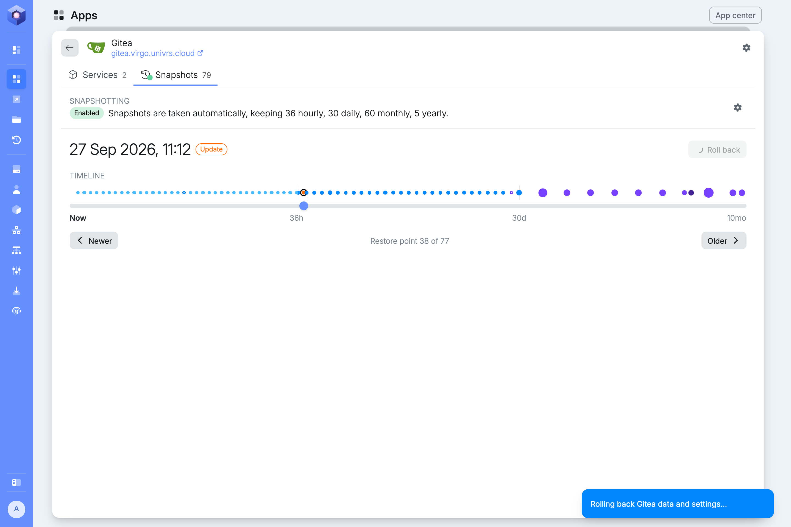

:::danger
Everything the app saved after the restore point is permanently lost, together with the snapshots taken since then.
:::

**Roll back** puts the whole app back the way it was at a restore point: its data, its settings and the versions it ran. Use it when an update broke the app.

You can roll back to the **Update** restore point, taken right before the app's latest update.

## Rolling an app back

Open the app's **Snapshots**, select the **Update** restore point, then **Roll back**, and confirm.

The node checks that the versions the app ran then can still be downloaded, stops the app, puts its data and settings back, downloads those versions and starts it again. A notification follows each step.

When a version can no longer be downloaded, the rollback stops before anything is changed and the notification says which part is missing.

## Nextcloud

Nextcloud can be rolled back too, but to get back a few files or folders, [browse](/management/resources/apps/snapshots/browse/), [search](/management/resources/apps/snapshots/search/) and [restore](/management/resources/apps/snapshots/restore/) them instead, and everything else stays as it is.

:::danger
Rolling back Nextcloud undoes every user's changes since the restore point. Get single files back by restoring them instead, unless most files are damaged, for example by ransomware or a virus that encrypted or deleted them.
:::
