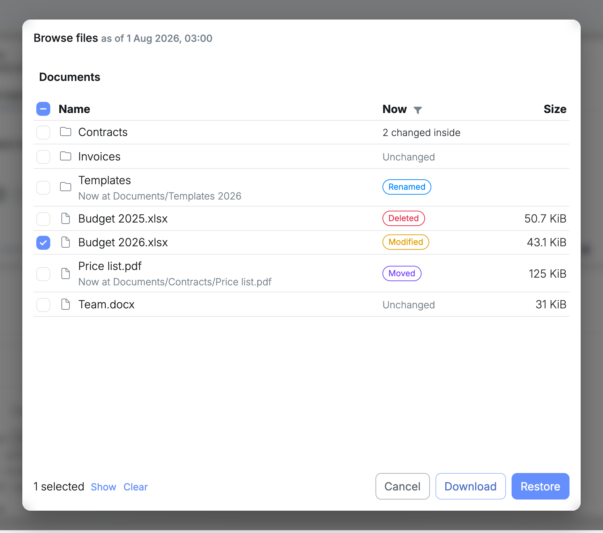
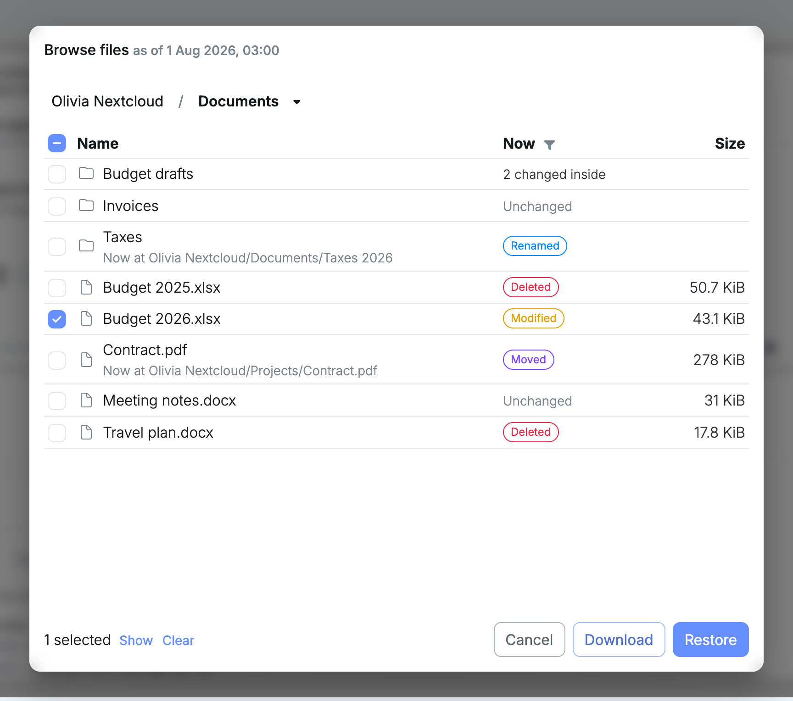

**Browse files** opens a folder as it was at one restore point.

1. Open the folder's details and select **Snapshots**.
2. Choose a restore point on the timeline.
3. Select **Browse files**.

It opens at the folder itself, with its name at the start of the path, and stays inside it. Paths further down, such as where a moved file is now, start with the folder's name too.

For a Nextcloud user's folder, that is the user's own files, with no way up to the other users.

Everything else works as in Nextcloud's **Browse files**: the **Now** column with what [changed since](/management/resources/apps/snapshots/browse/#what-changed-since-then), the [filter](/management/resources/apps/snapshots/browse/#showing-only-what-changed) for what changed, [selecting](/management/resources/apps/snapshots/browse/#selecting-files-and-folders) files and folders, [downloading](/management/resources/apps/snapshots/browse/#downloading-the-selection) them and [restoring](/management/resources/folders/snapshots/restore/#restoring-a-selection) them.
