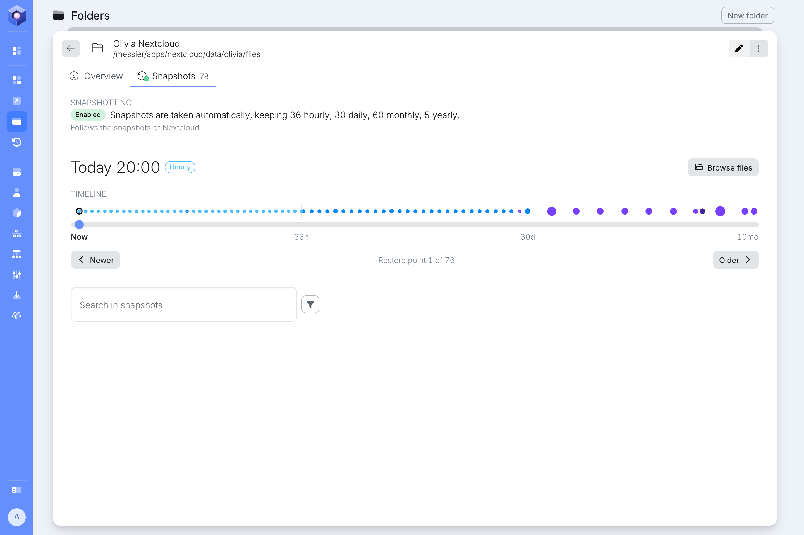

A snapshot is a read-only copy of a folder's files as they were at one moment. The node takes them by itself and removes old ones, following the pool's [snapshot schedule](/management/system/storage/#usage). A snapshot only takes up space for what has changed since it was taken, so keeping many of them costs little.

Open a folder's details and select **Snapshots**.

## Snapshotting

The top of the tab says whether the node takes snapshots of the folder, and how many of each kind it keeps. The dot on the **Snapshots** tab and the icon in the list show the same state: green for enabled, orange for paused and grey for disabled.

Where the snapshots come from depends on the folder.

### A new share

A folder added as a new share has snapshots of its own. The buttons next to the state change them:

- **Pause:** stop taking new snapshots. The ones already taken are kept.
- **Disable:** stop taking snapshots and delete the ones already taken, after you confirm.
- **Resume** or **Enable:** take snapshots again.

:::caution
Disabling snapshots permanently deletes every snapshot of the folder. Without them, files that are deleted, overwritten or encrypted by mistake cannot be recovered. To keep the existing snapshots, pause them instead.
:::

### A Nextcloud user's folder

A folder that shares a Nextcloud user's files has Nextcloud's snapshots. The tab shows Nextcloud's state, says it follows Nextcloud, and has no buttons: change it in [Nextcloud's snapshots](/management/resources/apps/snapshots/#snapshotting).

A folder that shares a Nextcloud group folder shows Nextcloud's state too, but its files can only be searched, browsed and restored from [Nextcloud's snapshots](/management/resources/apps/snapshots/#getting-files-back).

### Downloads

A folder that shares Downloads has no snapshots.

## Restore points

Below the state are the folder's restore points, with the same [timeline](/management/resources/apps/snapshots/#timeline) as an app's. Choose a restore point by its dot, by dragging the slider, or with **Newer** and **Older**.

## Getting files back

The files in a folder's restore points can be searched, browsed and restored, and everything stays inside that folder. In a Nextcloud user's folder, the other users' files, the trash and the group folders do not show up.

| You know | Start here |
| --- | --- |
| Roughly when things were still right | [Browse files](/management/resources/folders/snapshots/browse/) of that restore point |
| The name of the file, but not when it went missing | [Search](/management/resources/folders/snapshots/search/) every restore point at once |
| Which version you want | [Restore](/management/resources/folders/snapshots/restore/) it, or download it to your computer |

The node catalogues the files in the folders' snapshots by itself, every hour at ten past. Searching, and what **Browse files** says about changes, both rely on that catalogue, so a new share shows them after its first run, and the newest changes show up after the next one.

A folder does not roll back. To put all of Nextcloud back, see [Rolling back](/management/resources/apps/snapshots/rollback/).
