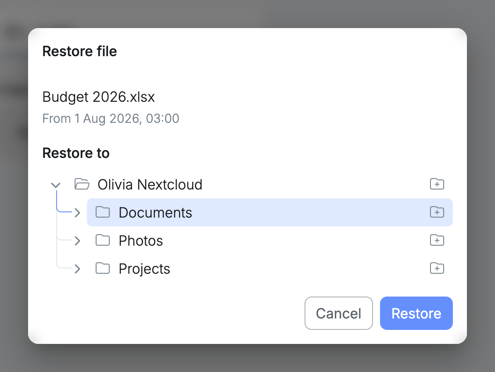

Restoring copies files out of a restore point and back into the folder, where they show up in Nextcloud by themselves. From a folder, files can only be restored into that same folder or the folders inside it.

## Restoring one file

In the [search results](/management/resources/folders/snapshots/search/), select the restore button next to a version. **Restore to** starts at the folder, with the folder the file was in already selected.

If the file was not there anymore, it is restored straight away. If a file with that name is there, you choose to [keep both or overwrite](/management/resources/apps/snapshots/restore/#the-folder-already-has-a-file-with-that-name).

## Restoring a selection

In [Browse files](/management/resources/folders/snapshots/browse/), select what you want and then **Restore**. Choose a folder inside the folder and select **Restore**. Everything arrives there in a new folder of its own, named after the restore point's date, as described in [Restoring a selection](/management/resources/apps/snapshots/restore/#restoring-a-selection).

Both ways can also [restore to a new folder](/management/resources/apps/snapshots/restore/#restoring-to-a-new-folder).
