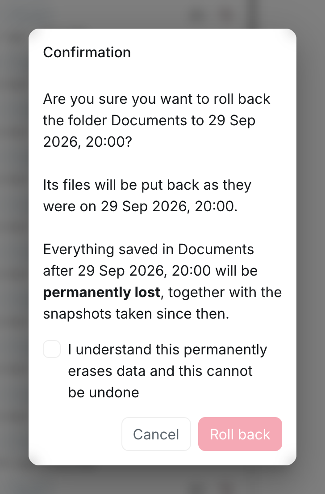
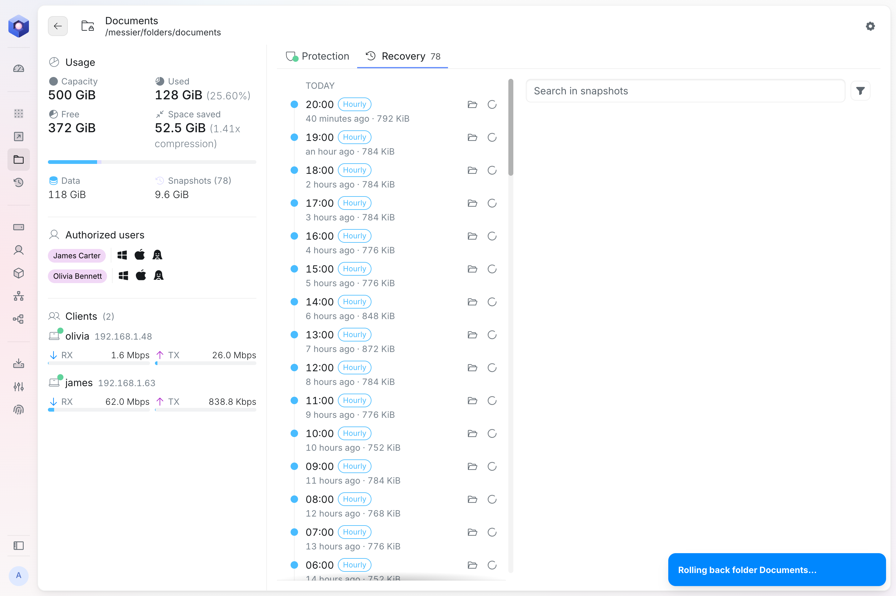

:::danger
Everything saved in the folder after the restore point is permanently lost, together with the snapshots taken since then.
:::

**Roll back** puts every file in a folder back the way it was at a restore point. Use it when most of the folder is damaged, for example by ransomware or a virus that encrypted or deleted its files. To get back a few files or folders, [browse](/management/resources/folders/snapshots/browse/), [search](/management/resources/folders/snapshots/search/) and [restore](/management/resources/folders/snapshots/restore/) them instead, and everything else stays as it is.

Only a folder added as a new share can be rolled back. A folder that shares a Nextcloud user's files follows [Nextcloud's rollback](/management/resources/apps/snapshots/rollback/).

## Rolling a folder back

Open the folder's **Recovery** tab and select **Roll back** next to a restore point. Tick **I understand this permanently erases data and this cannot be undone**, then select **Roll back** again.

A notification shows when the folder has been rolled back.

