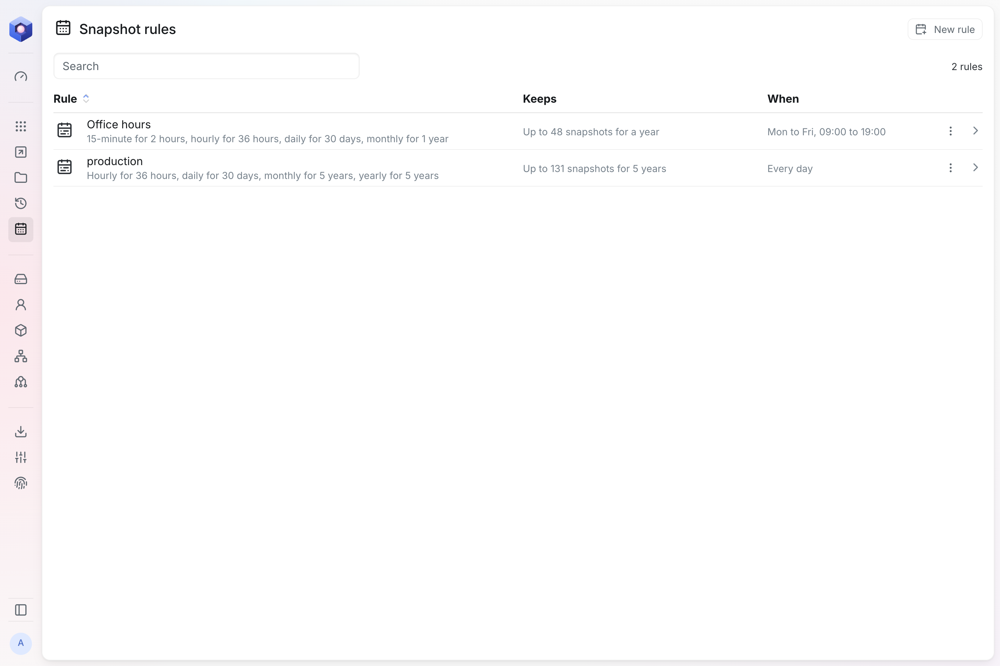
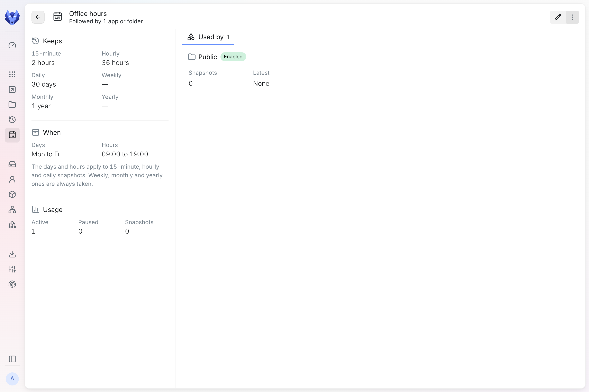
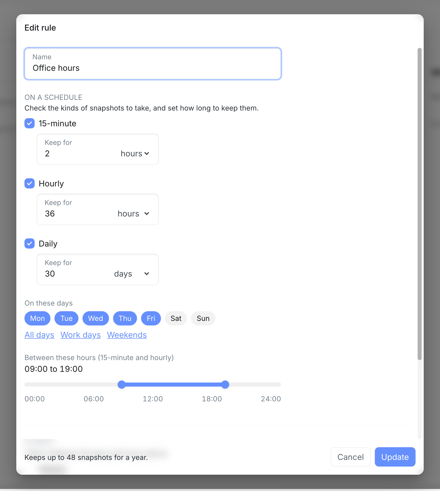

A snapshot rule decides when the node takes snapshots of an app or a folder and how many of each kind it keeps. You can make as many rules as you need and give each app and folder the one that fits it, in its **Protection** tab.

The list shows each rule with how long it keeps each kind of snapshot. **Keeps** adds them up: how many snapshots the rule keeps at most, and how far back they reach. **When** shows the days and hours it takes them. Sort the list by name with the arrows in the column header, and use **Search** to find a rule by its name.

## A rule's details

Select a rule to open its details. **Overview** shows what the rule keeps, the days and hours it takes snapshots, and how many of the apps and folders that follow it are active or paused, with their snapshots in total. **Used by** lists each app and folder that follows the rule, whether its snapshots are enabled or paused, how many snapshots it has and when the latest was taken. Select one to open it. Select the arrow in the top left corner to go back to the list.

## Adding a rule

Select **New rule**, give it a **Name**, then check the kinds of snapshots it takes and set how long each is kept, for example hourly ones for 36 hours and daily ones for 30 days. A kind that is not checked is not taken at all, and the snapshots of that kind already taken are removed. The line at the bottom adds them up: how many snapshots the rule keeps at most, and how far back they reach.

Hourly snapshots are taken on the hour, daily ones at 23:59, weekly ones on Monday at 23:30, monthly ones at midnight on the first of the month, and yearly ones at midnight on 1 January.

### On a schedule

15-minute, hourly and daily snapshots follow the days and hours under them:

- **On these days:** all three are taken only on the selected days. **All days**, **Work days** and **Weekends** select those days at once.
- **Between these hours:** snapshots every 15 minutes and hourly ones are taken only between the two ends of the slider.

For an office that works Monday to Friday from 9:00 to 19:00, select Monday to Friday, then drag the slider to 09:00 to 19:00. Snapshots are then taken during working hours and none at night or over the weekend. With fewer days or hours, fewer snapshots fit in the same time, so the rule keeps fewer of them.

Now and then a snapshot is taken outside the chosen hours, when one is due at the same moment as a snapshot that is allowed. An hourly one can come with the daily one at night, and the first working day after a weekend gets one more daily one just after midnight. They take almost no space, since nothing changed in the meantime.

### Always

Weekly, monthly and yearly snapshots are taken whatever the days and hours above.

## Editing a rule

Open a rule's **⋮** menu and select **Edit**. The changes apply to every app and folder that follows the rule, from their next snapshot. Renaming a rule keeps the apps and folders that follow it. The default rule, followed by every app and folder without a rule of its own, cannot be changed.

## Deleting a rule

Open a rule's **⋮** menu and select **Delete**. A rule can only be deleted once no app or folder follows it, so choose another rule for them first. The default rule cannot be deleted.

## Choosing a rule for an app or folder

In the app's or folder's details, open **Protection** and select the rule under **Rule**. See [app snapshots](/management/resources/apps/snapshots/#rule) and [folder snapshots](/management/resources/folders/snapshots/#rule).
