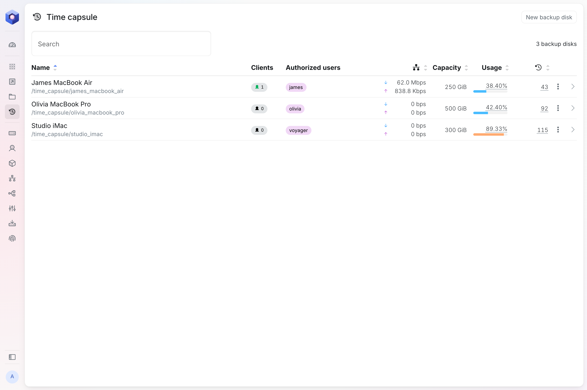
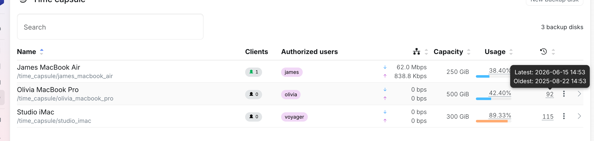
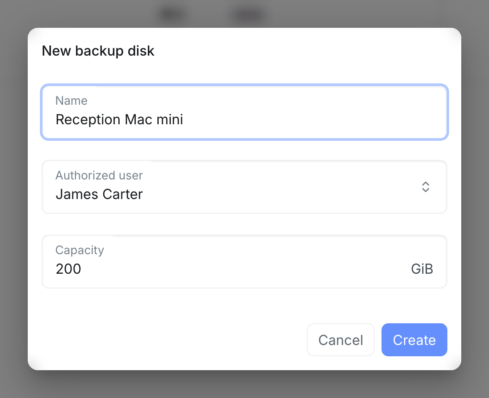
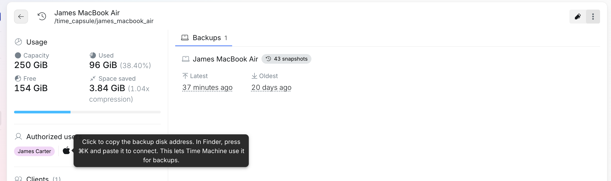
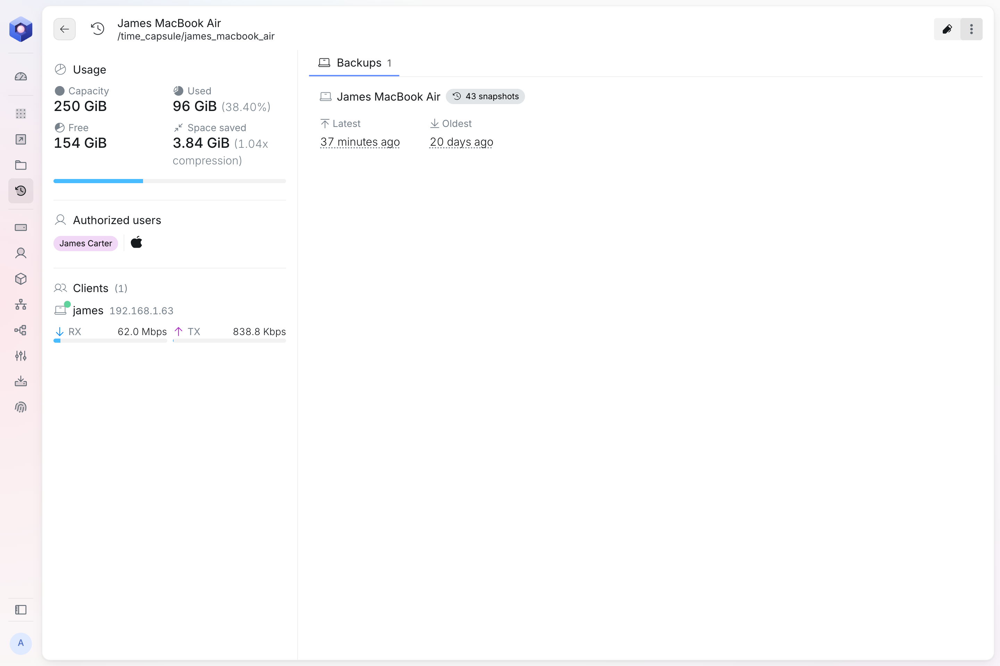
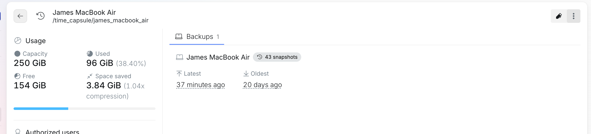
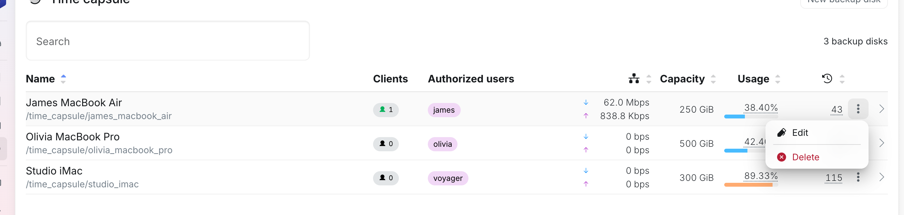
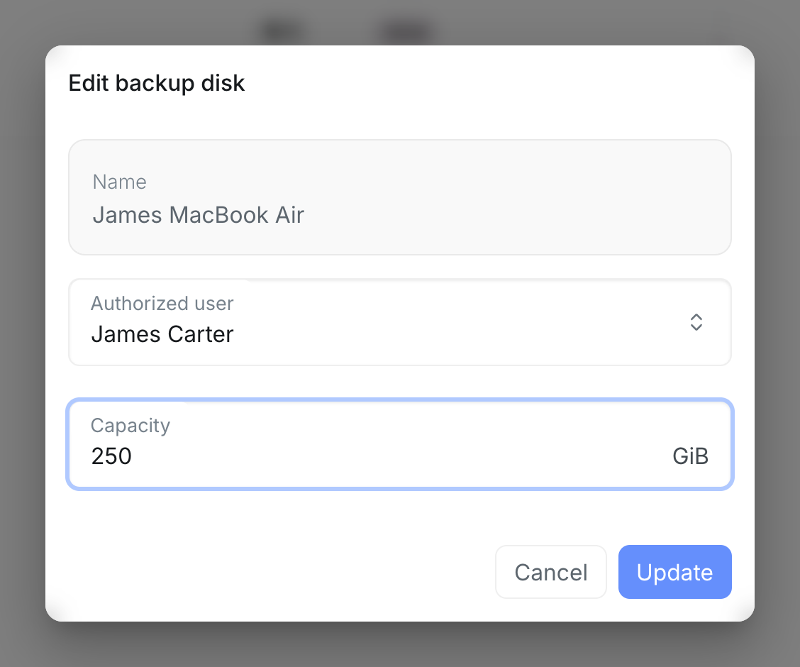

On a Mac, the node shows up as a **time capsule**. It holds **backup disks**, the destinations the Time Machine app backs up to. Each backup disk has its own space in the storage pool, with a capacity of its own, and one user who can reach it with their node username and password.

For each backup disk, the list shows its name, how many Macs are connected to it right now, the user who can reach it, how much data it receives and sends per second, its capacity, how much of it is used and how many backups Time Machine has stored in it. Hover over the number of Macs to see who is connected and from which address. Sort the list by name, traffic, capacity, usage or backups with the arrows in the column headers, and use **Search** to find a backup disk by its name or its user.

Hover over the number of backups to see the latest and the oldest.

## Adding a backup disk

Select **New backup disk**, then enter:

- **Name:** what the backup disk is called, for example after the Mac that backs up to it.
- **Authorized user:** the user whose node username and password the Mac connects with.
- **Capacity:** how much space its backups can take up, in GiB.

## Backing up a Mac

1. On the **Time capsule** page, open the backup disk and select the Apple icon next to its authorized user. This copies its address, for example `smb://olivia@192.168.1.10/backup_disk_olivia_macbook_pro`. The address is the [virtual IP](/setup/interface/), the address the node shares with its cluster.
2. On the Mac, in Finder, press **⌘K**, paste the address and select **Connect**. When asked, enter the authorized user's node username and password.
3. Open **System Settings**, select **General**, then **Time Machine**. Select **Add Backup Disk**, choose the backup disk and follow the steps.

The Mac reaches the node over your local network only, so it backs up while it is on the same network as the node.

Locking the authorized user stops the Mac from backing up, because it can no longer connect. Unlocking them lets it back up again.

## Backup disk details

Select a backup disk in the list to see it in detail.

- **Usage:** the backup disk's capacity, how much of it is used and how much is free. **Space saved** shows how much space compression saves.
- **Authorized users:** the user who can reach it, with the Apple icon that copies its address.
- **Clients:** the Macs connected to it right now, with the user, the Mac's address and how much data the backup disk receives from it and sends to it per second.

The **Backups** tab lists each Mac that backs up to the backup disk, with how many backups it has stored, the latest and the oldest. Hover over the latest or the oldest to see its date and time. Select the arrow in the top left corner to go back to the list.

## Capacity and history

Time Machine sees the capacity as the size of the backup disk. It keeps hourly backups for the past 24 hours, daily backups for the past month and weekly backups for all previous months. When the backup disk is full, it deletes the oldest backups to make room.

Backup disks are not part of the pool's [snapshots](/management/system/storage/#usage). Time Machine keeps its own history, the backups counted in the list.

## Editing or deleting a backup disk

Open a backup disk's menu in the list:

- **Edit:** change the authorized user or the capacity. The name stays the same.
- **Delete:** permanently delete the backup disk and every backup in it.

In a backup disk's details, the pen edits the backup disk and the menu next to it deletes it.

While a change is being applied, a spinning gear takes the place of the menu.

## On the Dashboard

The **Dashboard** lists the backup disks under **Time capsule**, with a bar showing how full each one is.

