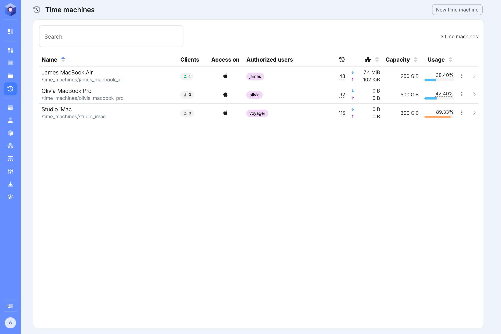
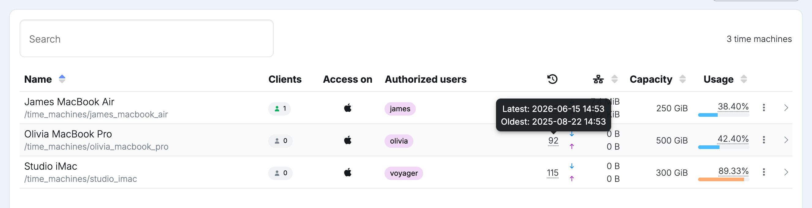
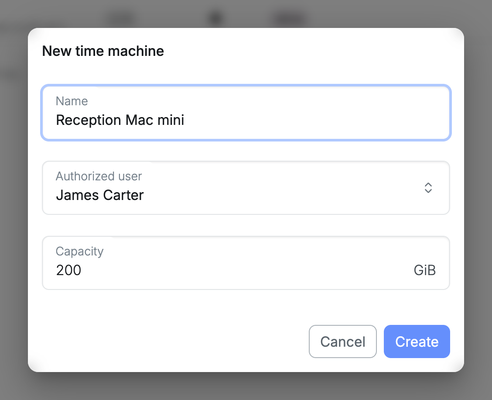
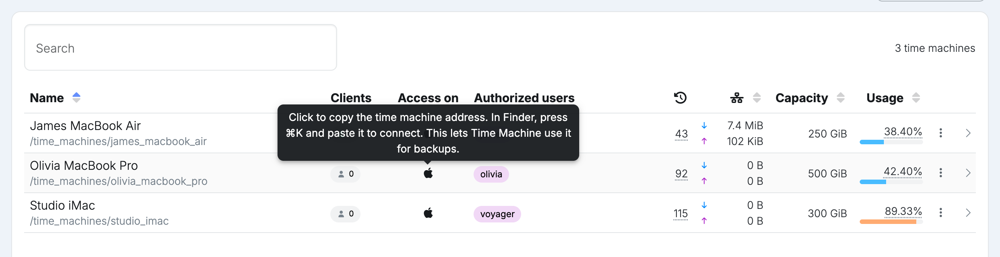
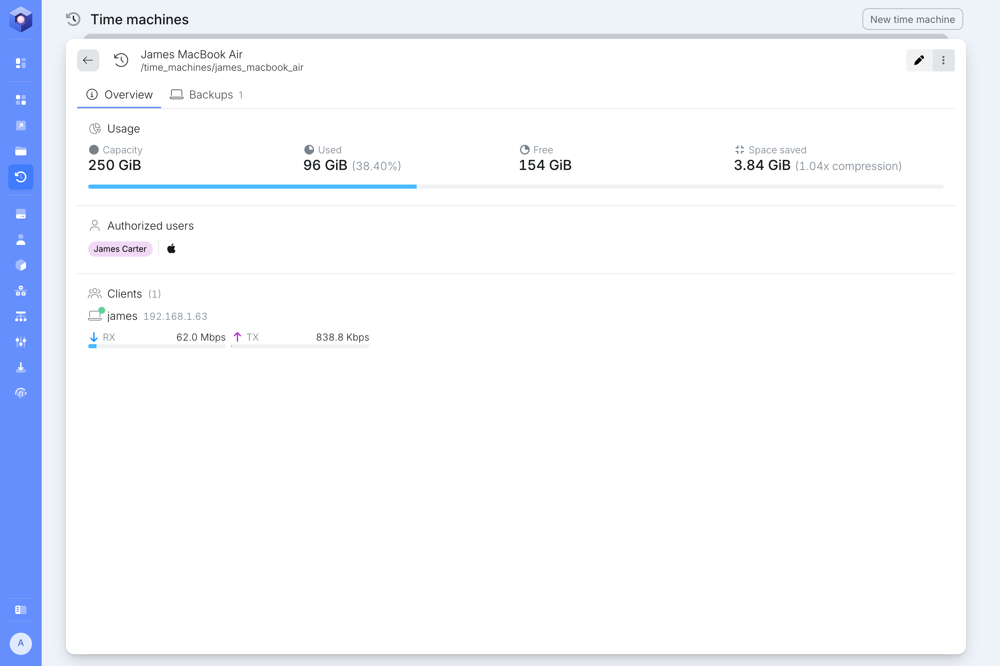
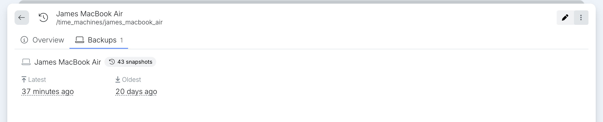
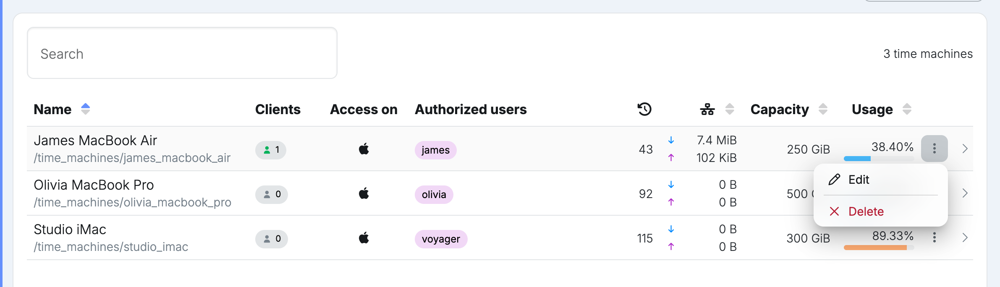
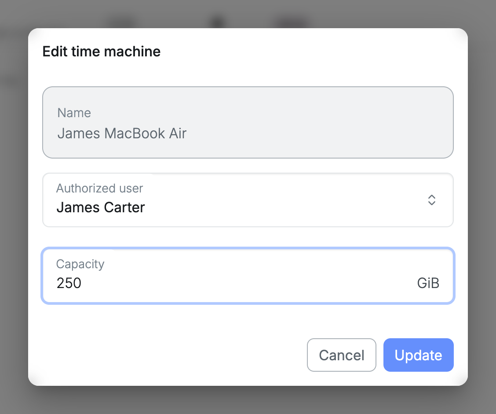

**Time machines** are backup destinations on the node for the Time Machine app on a Mac. Each one has its own space in the storage pool, with a capacity of its own, and one user who can reach it with their node username and password.

For each time machine, the list shows its name, how many Macs are connected to it right now, the user who can reach it, how much data it receives and sends per second, its capacity, how much of it is used and how many backups Time Machine has stored in it. Hover over the number of Macs to see who is connected and from which address. Sort the list by name, traffic, capacity, usage or backups with the arrows in the column headers, and use **Search** to find a time machine by its name or its user.

Hover over the number of backups to see the latest and the oldest.

## Adding a time machine

Select **New time machine**, then enter:

- **Name:** what the time machine is called, for example after the Mac that backs up to it.
- **Authorized user:** the user whose node username and password the Mac connects with.
- **Capacity:** how much space its backups can take up, in GiB.

## Backing up a Mac

1. On the **Time machines** page, open the time machine and select the Apple icon next to its authorized user. This copies its address, for example `smb://olivia@192.168.1.10/time_machine_olivia_macbook_pro`. The address is the [virtual IP](/setup/interface/), the address the node shares with its cluster.
2. On the Mac, in Finder, press **⌘K**, paste the address and select **Connect**. When asked, enter the authorized user's node username and password.
3. Open **System Settings**, select **General**, then **Time Machine**. Select **Add Backup Disk**, choose the time machine and follow the steps.

The Mac reaches the node over your local network only, so it backs up while it is on the same network as the node.

Locking the authorized user stops the Mac from backing up, because it can no longer connect. Unlocking them lets it back up again.

## Time machine details

Select a time machine in the list to see it in detail.

- **Usage:** the time machine's capacity, how much of it is used and how much is free. **Space saved** shows how much space compression saves.
- **Authorized users:** the user who can reach it, with the Apple icon that copies its address.
- **Clients:** the Macs connected to it right now, with the user, the Mac's address and how much data the time machine receives from it and sends to it per second.

The **Backups** tab lists each Mac that backs up to the time machine, with how many backups it has stored, the latest and the oldest. Hover over the latest or the oldest to see its date and time. Select the arrow in the top left corner to go back to the list.

## Capacity and history

Time Machine sees the capacity as the size of its backup disk. It keeps hourly backups for the past 24 hours, daily backups for the past month and weekly backups for all previous months. When the time machine is full, it deletes the oldest backups to make room.

Time machines are not part of the pool's [snapshots](/management/system/storage/#usage). Time Machine keeps its own history, the backups counted in the list.

## Editing or deleting a time machine

Open a time machine's menu in the list:

- **Edit:** change the authorized user or the capacity. The name stays the same.
- **Delete:** permanently delete the time machine and every backup in it.

In a time machine's details, the pen edits the time machine and the menu next to it deletes it.

While a change is being applied, a spinning gear takes the place of the menu.

## On the Dashboard

The **Dashboard** lists the time machines too, with a bar showing how full each one is.

