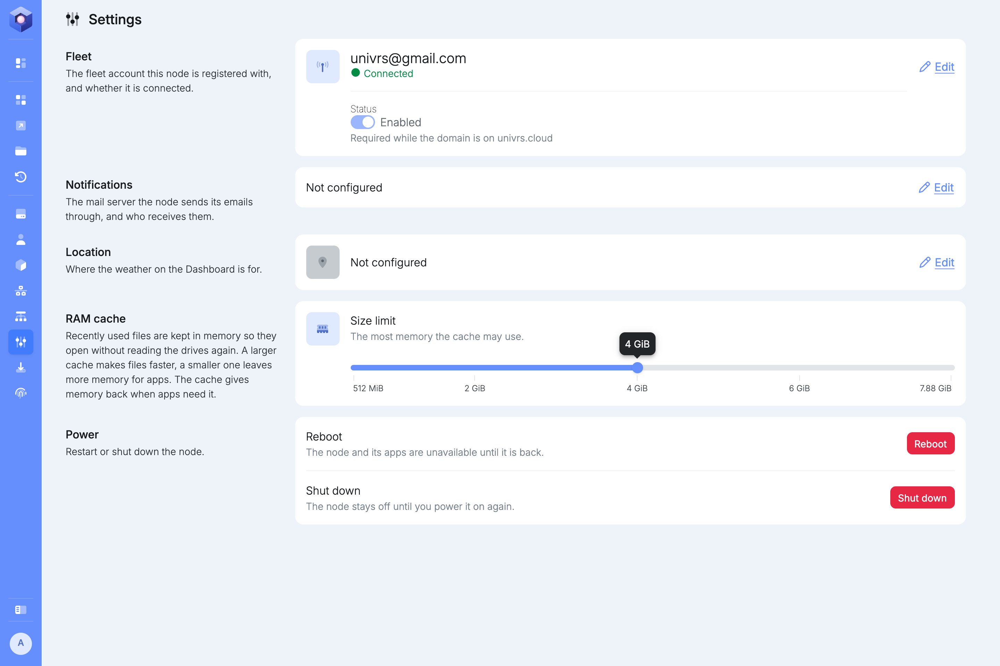
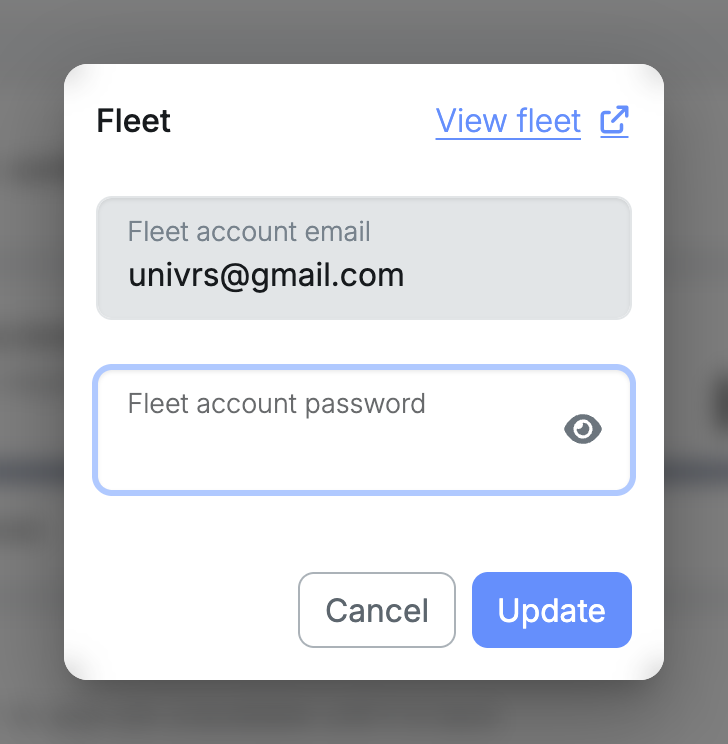
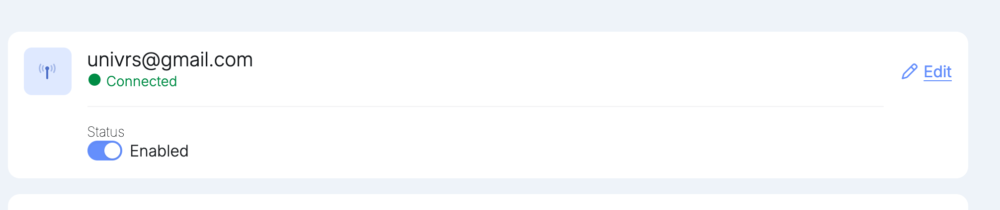
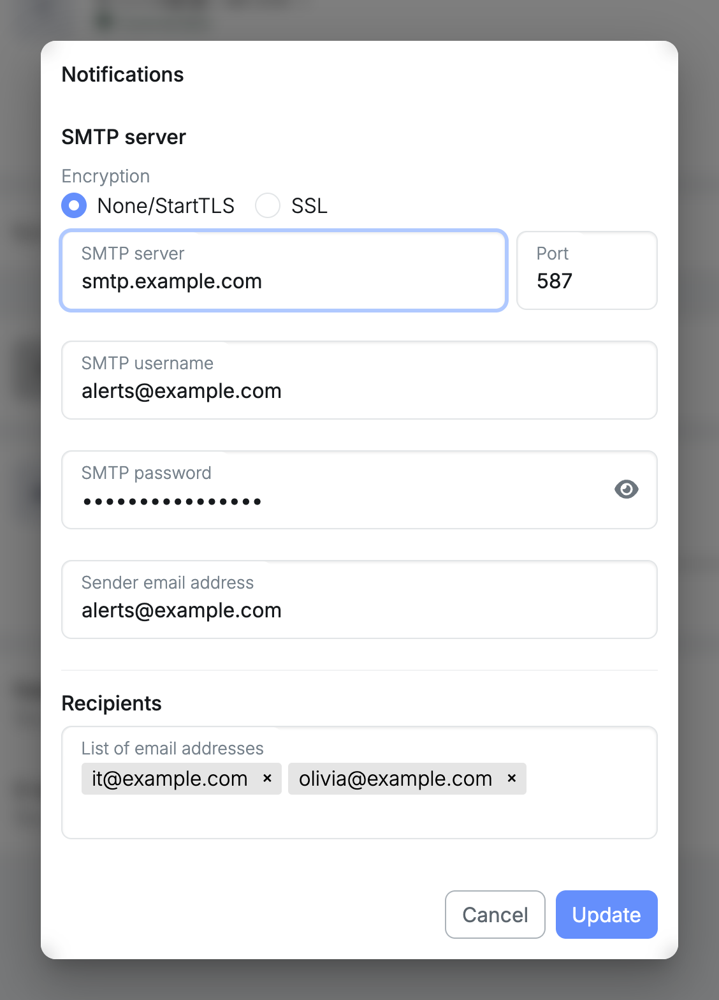
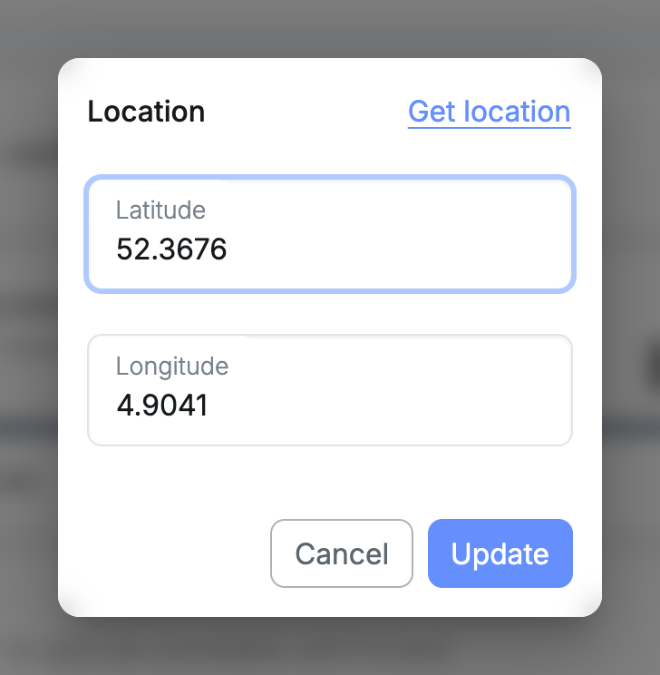
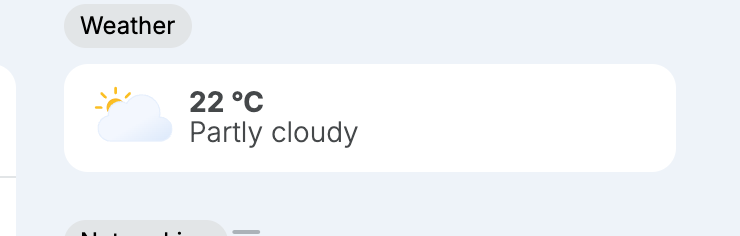
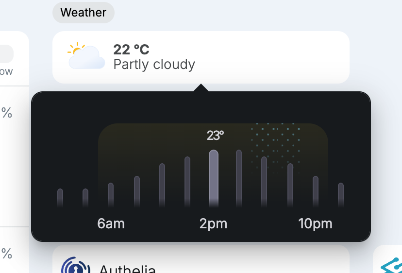
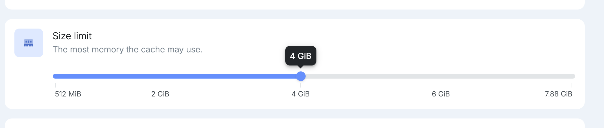
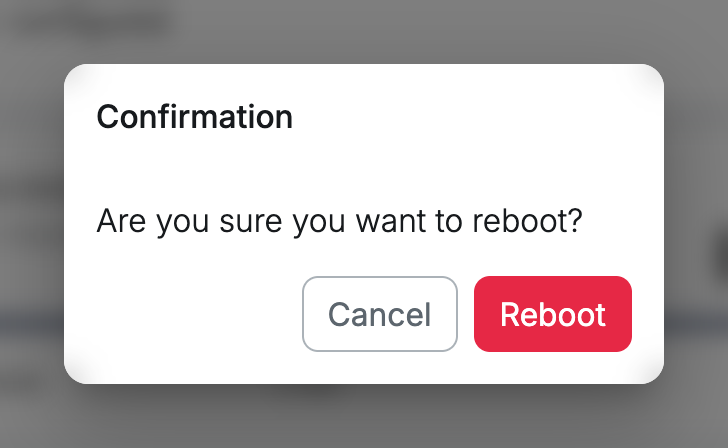
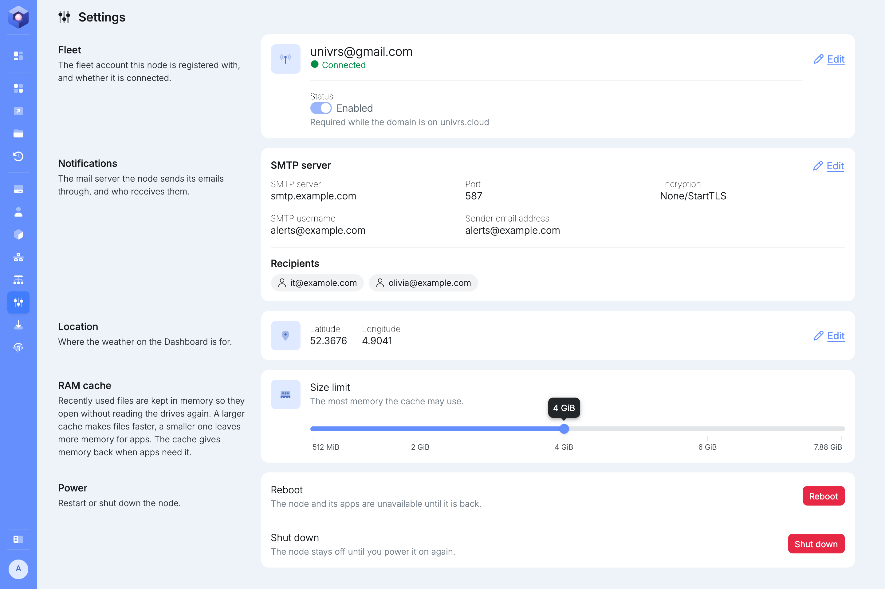

**Settings** holds the node's fleet registration, its email notifications, its location, its RAM cache and the power buttons. On a fresh install, **Fleet** shows the registration made during setup, **Notifications** and **Location** are not configured yet, **RAM cache** is limited to 1.5 GiB, and **Power** lets you reboot or shut down the node.

## Fleet

The **Fleet** card shows the fleet account the node is registered with and whether it is connected. Select **Edit** to register it with a fleet account again, or **Register** if it is not registered yet.

**Status** turns the connection to the fleet on or off. On `univrs.cloud` it cannot be turned off, because the fleet provides the node's DNS record and certificate. On your own domain it can.

If the card says **Registration expired, please re-register.**, select **Edit** and register again.

## Notifications

The node emails you about problems with its storage pool and drives, and about what changed when updates are installed. For that it needs an SMTP server to send through. Select **Edit** on the **Notifications** card.

- **Encryption:** **None/StartTLS** for servers that start encryption on the connection, usually on port 587, or **SSL** for servers that expect it from the start, usually on port 465.
- **SMTP server** and **Port:** the address and port of the mail server.
- **SMTP username** and **SMTP password:** the account the node signs in to the mail server with. Leave both empty if the server does not ask for one.
- **Sender email address:** the address the emails come from.
- **Recipients:** the addresses the emails go to. Separate addresses with a comma or a space.

## Location

The location sets where the weather on the **Dashboard** is for. Select **Edit** on the **Location** card, then enter the latitude and longitude, or select **Get location** to use your browser's location.

Once a location is set, the **Dashboard** shows the current weather there, updated every hour.

Select it to see today's temperatures every two hours, with the current time highlighted. The shaded part is daylight, and dotted columns mark hours with a chance of rain.

## RAM cache

The node keeps recently used files in memory, so opening them again does not need the drives. This cache is the ZFS ARC, the memory cache of the storage pool. The **RAM cache** card sets the most memory that cache may use. A larger cache makes files open faster, a smaller one leaves more memory for apps. The cache gives memory back when apps need it, so the limit is a ceiling, not memory set aside.

The limit matters most during heavy reading, such as a data integrity check, a backup or a large copy, when the cache would otherwise keep growing. The [Dashboard](/management/dashboard/#ram) shows how much of the limit the cache uses and how often it saves a trip to the drives.

Drag the slider to the new **Size limit**. The bubble above it shows the size, and the new limit takes effect as soon as you let go, without a reboot. It is kept when the node restarts.

## Power

**Reboot** restarts the node, after you confirm.

**Shut down** turns the node off, after you confirm. It stays off until you power it on again.

## Everything configured

