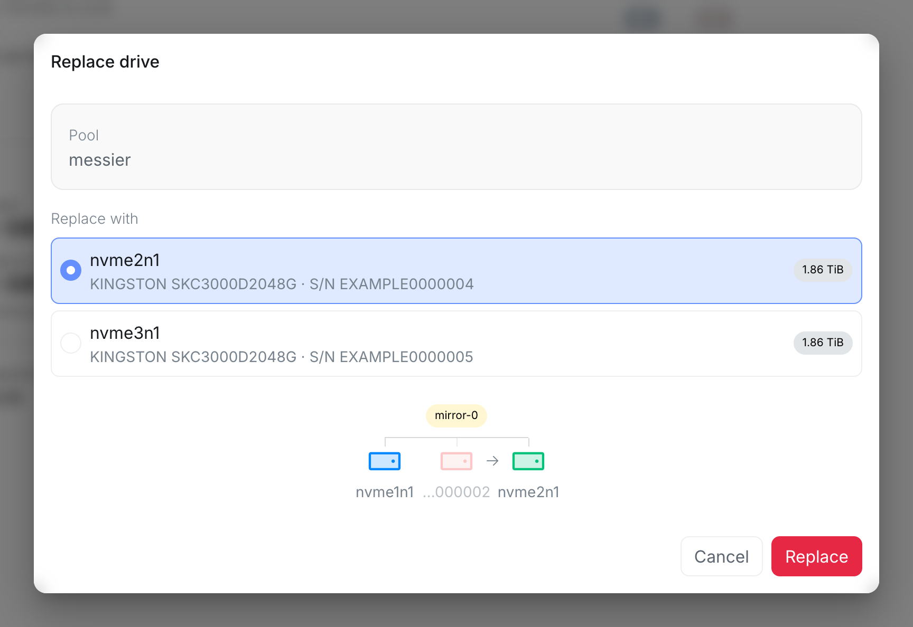
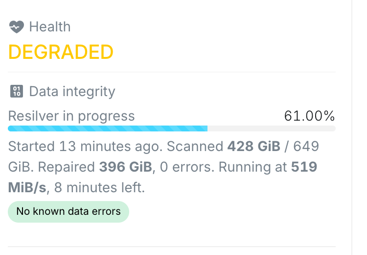
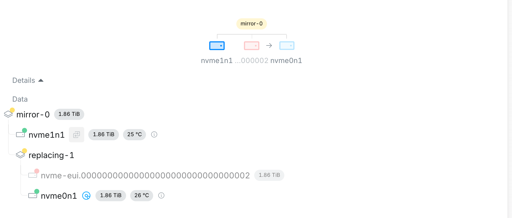

Any drive in the [storage pool](/management/system/storage/) can be swapped for a new one: a drive that has failed, one that reports problems in its health check, or a healthy one you want to retire or swap for a bigger one.

## Starting a replacement

Fit the new drive first, in a free bay if there is one. Then select the old drive in the pool's topology. Only drives that can be replaced right now can be selected.

The window lists the unused drives that can take its place, with the smallest one selected. Below them, the drive's group shows the old drive with the one you picked next to it. Select **Replace**. A confirmation names the drive that will be erased; tick **I understand and want to proceed** and select **Replace** again to start.

When the new drive is bigger, the window says when the pool grows: a group only grows once every drive in it is bigger.

## Which drives can be replaced

- A failed drive, or one that reports problems, can be replaced as long as the pool can still be repaired, even while another drive is being rebuilt. Each failed drive gets its own replacement.
- A healthy drive can only be replaced while every drive in the pool is healthy, no other drive is being replaced or rebuilt, and no data integrity check is running. Healthy drives are replaced one at a time, and while another drive has failed or reports problems, they are not offered at all.

## With no free bay

If every bay is taken, take the old drive out and put the new one in its place. The pool then shows the old drive as missing, as in [When a drive is missing](/management/system/storage/#when-a-drive-is-missing), and the new drive shows up as unused within a minute, or right away with the reload button. Replace the missing drive with it.

Until the new drive is filled, that group has no redundancy left. With a free bay, the old drive keeps working until the new one is filled, so that is the safer way when you have one.

## Resilvering

As soon as the new drive is in the pool, ZFS copies the pool's data onto it. This is a **resilver**. It shows in **Data integrity** with its progress and how long it has left. If the old drive had failed, the pool stays **DEGRADED** until it finishes.

In the topology, the old drive and the new one appear side by side, with an arrow from the old one to the new one, and the new one shows a spinning disc while it is being filled.

Only the data actually stored is copied, so a resilver takes as long as it takes to copy what the pool holds, not the whole drive. When it finishes, the old drive disappears from the topology and the pool is **ONLINE** again.
