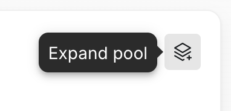
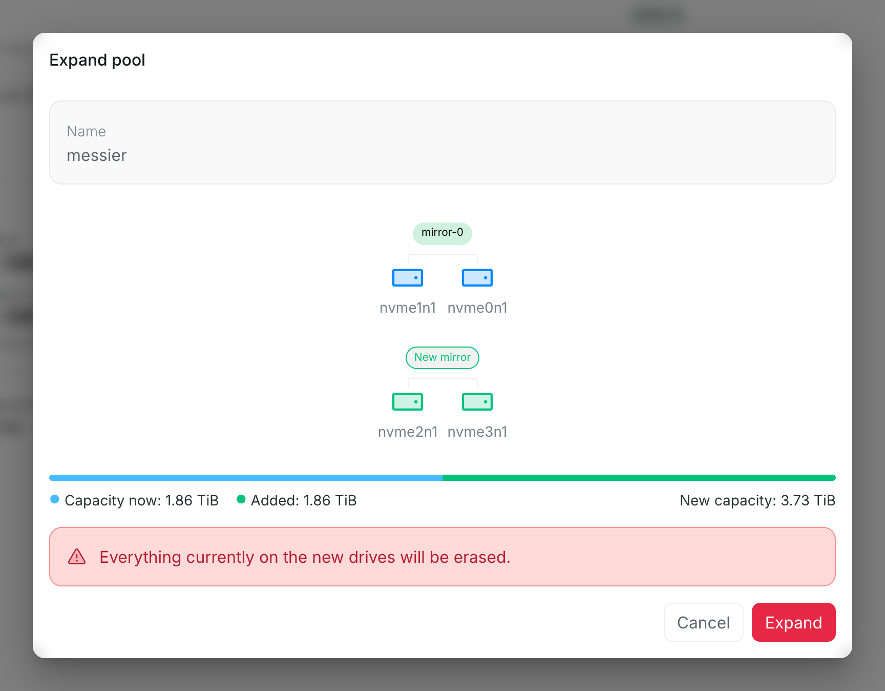

When drives that are not part of the [storage pool](/management/system/storage/) are fitted, the pool can grow onto them. Select the expand button at the top right of the pool, or **Expand pool** in the pool's menu in the list. When the pool cannot grow, the button is grayed out; hover over it to see why.

The new drives are added in groups laid out like the pool's own, here a mirror of two drives. The pool's current groups are at the top and the new ones below them. A drive that does not fill a whole group is shown under **Unused** and stays out of the pool. The bar shows the capacity now, what the new groups add, and the capacity after.

Everything on the new drives is erased. Select **Expand** to add them; a notification shows when the pool has grown.
