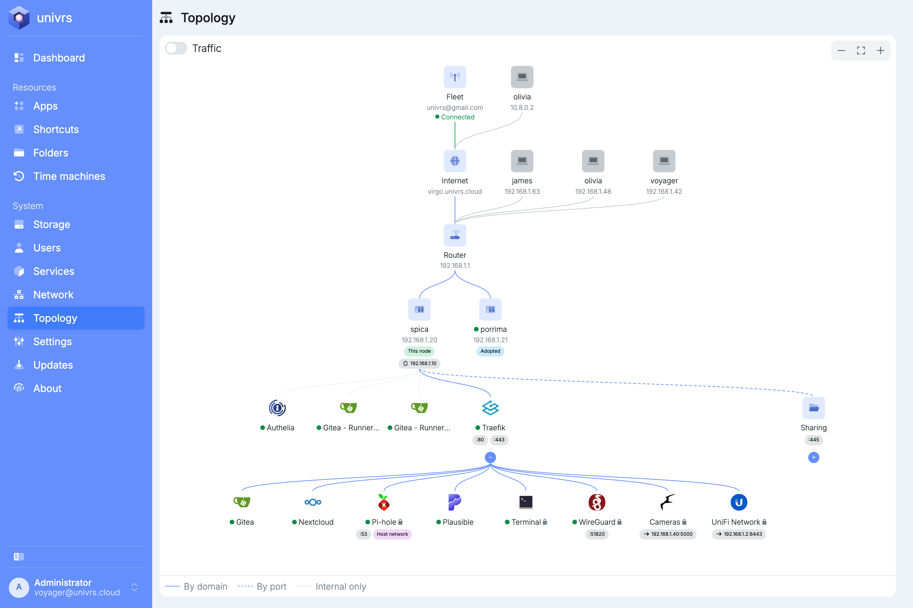
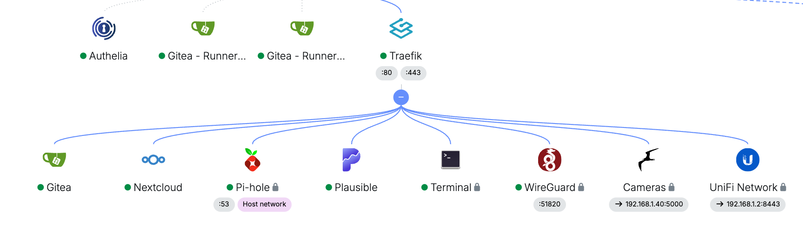
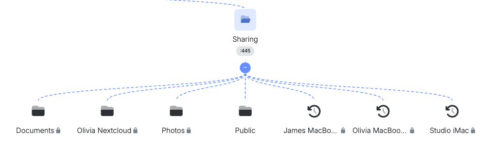
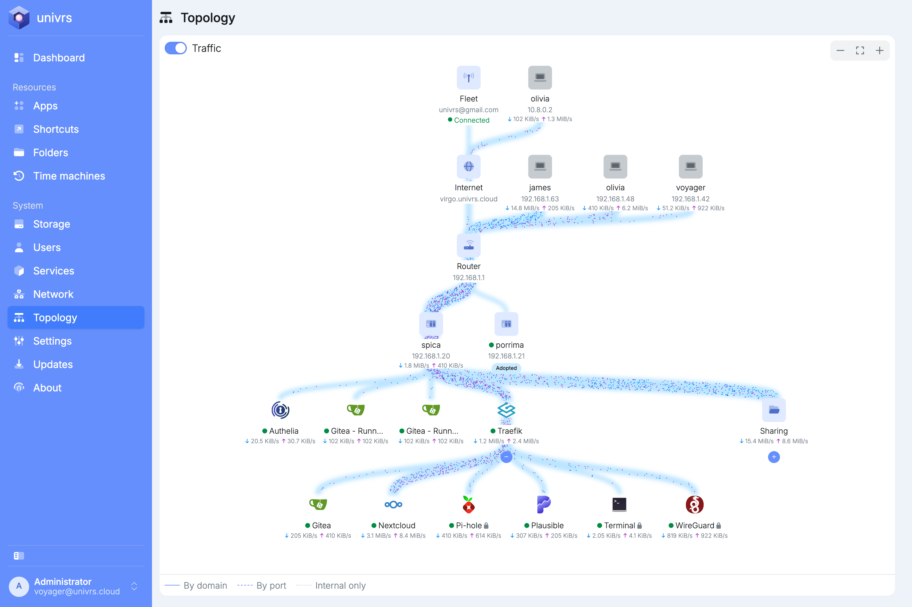
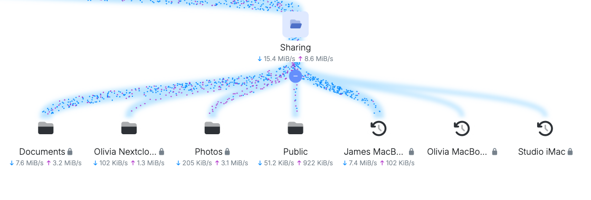

**Topology** draws what can reach what on the node, on one page: how traffic gets in, which apps need a login and which are open, what is shared on your local network, which other nodes are around and whether each app is running. The other pages each show one part of this. Here it comes together, so you can check what is exposed at a glance or show it to someone else, such as an auditor.

The map shows how the node is set up. Whether something is actually reachable from the internet also depends on which ports your router forwards to the node.

## From the internet to the node

The top of the map follows the way in:

- **Fleet**, when the node is registered with one, with the account and whether the node is connected.
- **Internet**, with your domain.
- **Router**, with its address.
- The node, with its address. Hover over its name to see its full name. A badge shows when it holds the virtual IP.

Computers that have a [folder](/management/resources/folders/) or [time machine](/management/resources/time-machines/) open are drawn next to **Internet**, with the user and the computer's address. Their lines join the map at the **Router**. Those connecting from outside your local network, such as over the VPN, are drawn at the top, next to **Fleet** when the node is registered with one, and join at **Internet**.

Other nodes found on your network are drawn next to it, marked **Adopted** or **Not adopted**. An adopted node has a dot in front of its name: green while it is online, red while it is not. Nodes are adopted from the **Dashboard**, see [Adopting a node](/management/dashboard/#adopting-a-node).

## Lines

The legend under the map explains the lines:

- **By domain:** reached at an address under your domain, such as `nextcloud.virgo.univrs.cloud`.
- **By port:** reached at the node's address on a port of its own, such as `192.168.1.10:53`.
- **Internal only:** not reachable from your network at all.

## Apps

Apps reached by domain hang under **Traefik**, the app that receives every visit to your domain and passes it on to the app the address belongs to. Hover over an app's name to see the addresses it answers on.

A lock next to an app's name means it is gated: **Authelia**, the app that asks for the login, checks every visit before Traefik lets it through. As everywhere on the node, the login applies from outside your local network, see [Authentication](/management/authentication/#on-your-local-network-and-over-the-vpn).

Shortcuts set to **Use proxy** appear among the apps, with an arrow to the address they open.

Apps reached by port show their ports. **Host network** means the app shares the node's own network and can use any of its ports.

Apps that nothing on your network can reach hang straight under the node, next to **Traefik**. **Authelia** is one of them: only Traefik talks to it, to check logins.

The dot in front of an app's name shows whether it is running: green when all of it is, orange when only part of it is, red when none of it is. Hover over the dot to see how many of its parts are running.

## Sharing

**Sharing** holds the folders and time machines, reached on your local network at port 445. A lock marks a private one. Hover over the lock to see who can use it.

## Traffic

Turn on **Traffic** in the top left corner to see how much data flows right now. Each line becomes a band that grows wider with the traffic passing through it, and dots move along it: blue dots for data coming in, travelling down to the app, and purple dots for data going out, travelling back up. A line carries everything that flows to the parts below it, so the busiest paths stand out.

The node, each app, each connected computer, **Sharing** and each folder and time machine show their current speeds under their name: received and sent per second. The node's figures come from its network card and include everything it sends and receives, not only the apps.

A computer's traffic flows through the node and **Sharing** to the folders and time machines it has open. Unfold **Sharing** to see which ones.

While traffic is shown, the map leaves out what has no traffic of its own to show, such as ports and shortcuts. Lines with no data to measure, such as the way in from the internet, stay still. Turn **Traffic** off to see the full map again.

## Moving around

- Drag the map to move it.
- Scroll, or pinch on a touch screen, to zoom in and out.
- Use the buttons in the top right corner to zoom out, fit the whole map in view, or zoom in.
- Select **−** or **+** under a part of the map to fold or unfold what hangs under it.
