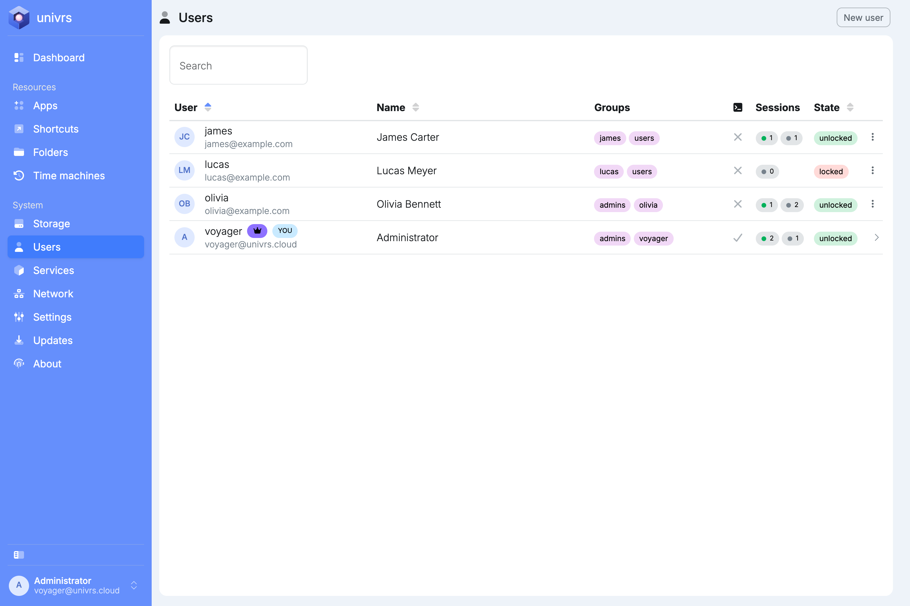
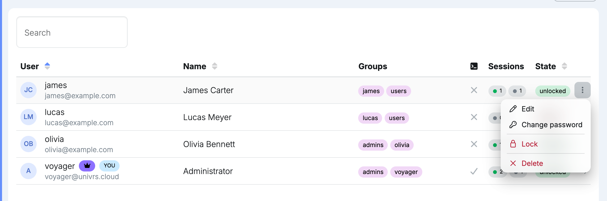
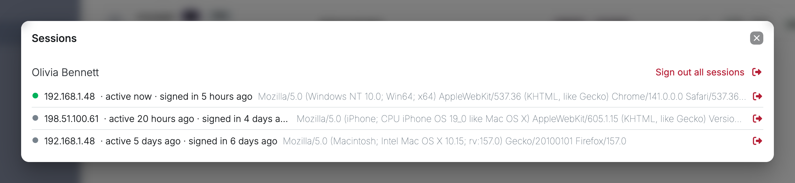
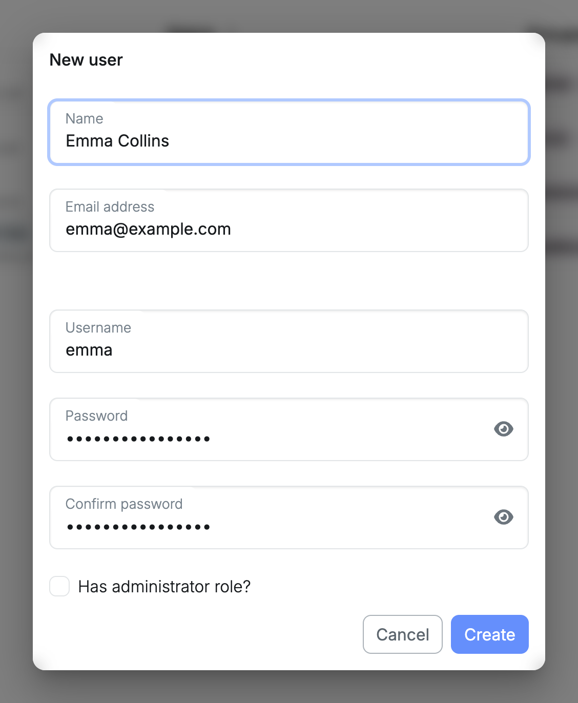

A user of the node signs in to the node itself, and uses the same username and password to reach folders and Time Machine backups. Apps keep their own users, separate from these.

## Roles

| Role | What they can do |
| --- | --- |
| Owner | The account whose password was set during setup. An administrator who cannot be locked or deleted, and whose profile and password only they can change. |
| Administrator | Every page in the menu, including managing users. |
| User | Sign in to the node, reach the folders and Time Machine backups they have access to, and manage their own [profile](/management/system/users/profile/). |

Only the owner can give a user the administrator role.

## Managing users

**Users** lists everyone who can sign in to the node. The owner is marked with a crown, and your own account with **YOU**.

Open a user's menu to manage them:

- **Edit:** change the user's name and email address. The owner can also change their role.
- **Change password:** set a new password for the user.
- **Lock:** stop the user from signing in and from reaching folders and time machines, without deleting them. **Unlock** gives them access again.
- **Delete:** remove the user.

Your own account has no menu here; it links to your [profile](/management/system/users/profile/) instead.

## Sessions

Each browser a user signs in from gets its own session, which lasts until the user signs out there or the session expires. The **Sessions** column counts them for every user: the green dot counts the sessions that have the node open right now, the grey dot the ones that are still signed in but not open.

Select the count to see that user's sessions.

Every session shows the address it is used from, whether it is active now or when it was last active, when it signed in, and the browser.

- **Sign out icon:** end that session. The user has to sign in again in that browser to reach the node.
- **Sign out all sessions:** end every session of that user.

On your own row the link is **Sign out everywhere else**, and it keeps the session you are using.

Locking or deleting a user signs them out everywhere as well.

Signing a session out does not end the user's sign-in to the apps themselves.

## Adding a user

Select **New user**, then enter a name, email address, username and password. The owner can also tick **Has administrator role?**.

