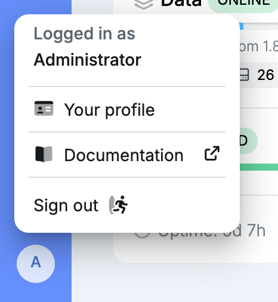
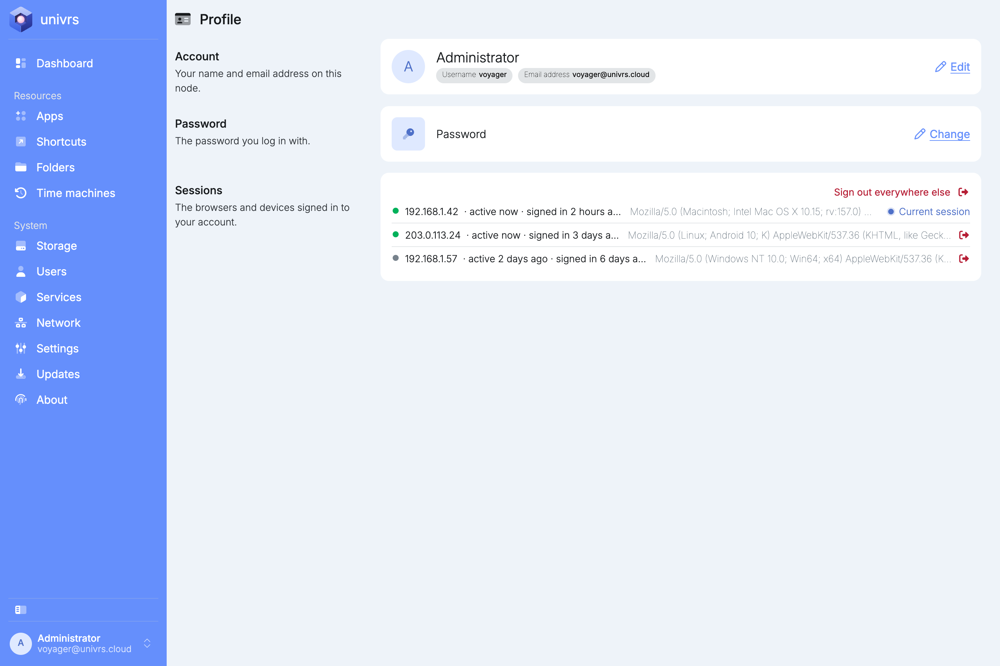
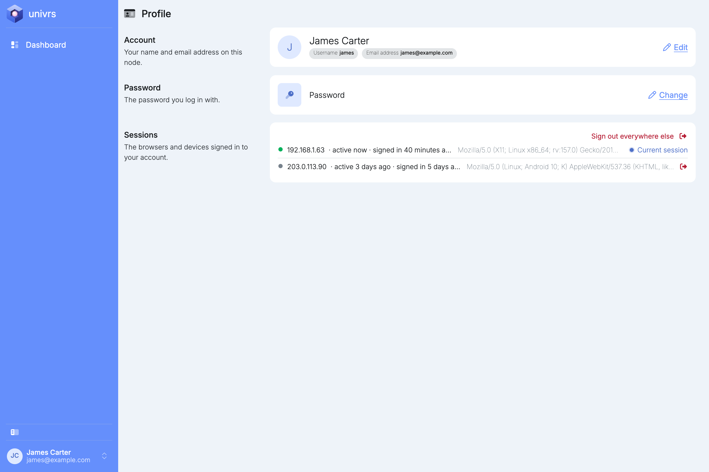
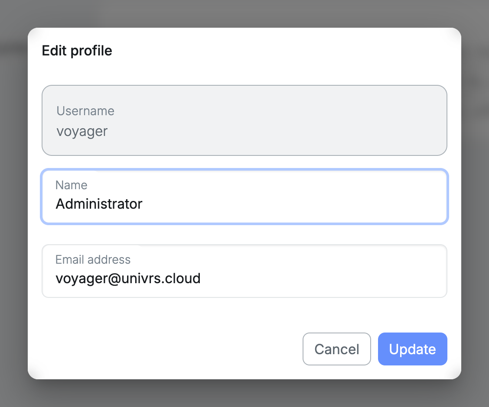
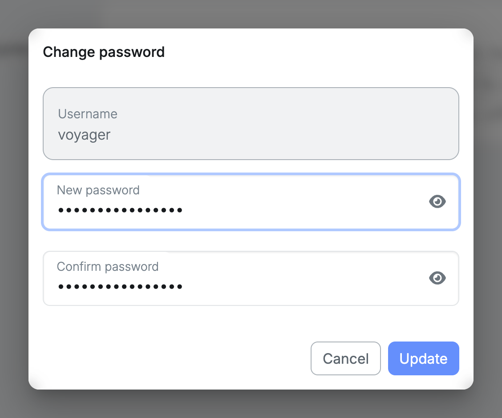
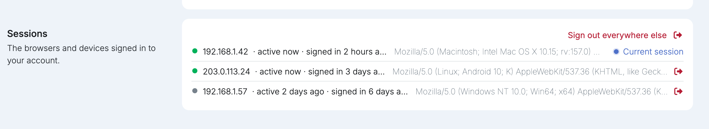

Every signed-in user has a profile, whatever their role. Open it from the account menu with your name, then select **Your profile**.

It shows your name, username and email address, and the sessions signed in to your account.

A user without the administrator role sees only the **Dashboard** and their profile.

## Editing your profile

Select **Edit** on the **Account** card to change your name and email address.

## Changing your password

Select **Change** on the **Password** card and enter the new password twice.

From then on, use the new password to sign in to the node and to reach folders and Time Machine backups. Passwords you use in apps are not changed.

## Your sessions

Each browser you sign in from gets its own session. **Sessions** lists the ones that are still signed in; a session leaves the list when you sign out there or it expires.

- **Current session:** the browser you are using now, marked with a blue dot.
- **active now:** the node is open in that browser right now, shown with a green dot.
- **active** followed by a time: you are still signed in there but the node is not open. The time is when it was last open.

Every session also shows the address it is used from, when it signed in, and the browser.

Select the sign out icon on a session to end it. You have to sign in again in that browser to use the node there. **Sign out everywhere else** ends every session except the one you are using.

If you see a session you do not recognise, sign it out and then change your password.
